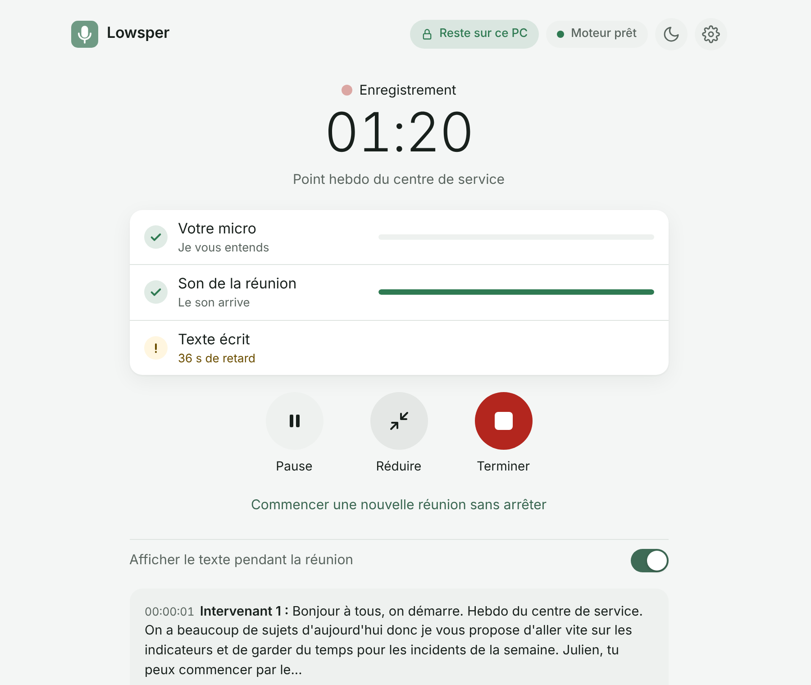

# Lowsper (English summary)

**100% local meeting transcription, in the browser, with nothing to install.**

Lowsper captures your microphone and the meeting audio (Teams, Zoom, Meet...), transcribes live with
Whisper, tells speakers apart, and gives you a timestamped Markdown transcript at the end, ready to
hand to an AI for meeting minutes. Neither audio nor text ever leaves the computer.

The interface and the full documentation are in French: see [README.md](README.md).

## Why it exists

- **No installation.** Lowsper is a single HTML file opened from disk (`file://`) in Edge or
  Chrome: no executable, no admin rights, no local server. It works on locked-down corporate
  laptops where installing software is not allowed.
- **Private by design.** Everything runs on the machine (Whisper through transformers.js and ONNX
  Runtime Web, in WebAssembly or WebGPU). The page's Content Security Policy blocks every network
  connection except the one-time model download from Hugging Face, and an automated test checks it
  on every pull request. Audio is never written to disk.
- **Built for meetings, not dictation.** Two sources (you and the other participants), speaker
  separation, custom glossary and domain vocabularies, a small always-on-top window, back-to-back
  meetings, and a safety net that never silently drops speech.

## Quick start

1. Download `Lowsper-X.Y.Z.zip` from the [latest release](https://github.com/PercyaDJ/Lowsper/releases/latest)
   and unzip it.
2. Open `Lowsper.html` in Edge or Chrome.
3. First launch only: pick a model, click « Installer » and select the Lowsper folder. The model
   (about 250 MB for Whisper small) is downloaded once and stored next to the page.
4. Click « Démarrer l'enregistrement », share your screen **with audio**, allow the microphone.
5. Click « Terminer »: the `.md` transcript lands in your Downloads folder.

Recognition is tuned for French (with an English and an automatic French/English mode).

## Learn more

- [docs/architecture.md](docs/architecture.md): how audio flows from the microphone to Markdown.
- [docs/deploiement.md](docs/deploiement.md): deployment guide for IT and security teams.
- [SECURITY.md](SECURITY.md): threat model and private vulnerability reporting.
- [decision.md](decision.md): every technical decision, with the options considered and measurements.
- [CONTRIBUTING.md](CONTRIBUTING.md): issues and pull requests are welcome, in French or English.

License: MIT. Third-party licenses: `app/engine/THIRD_PARTY_LICENSES.txt`.
