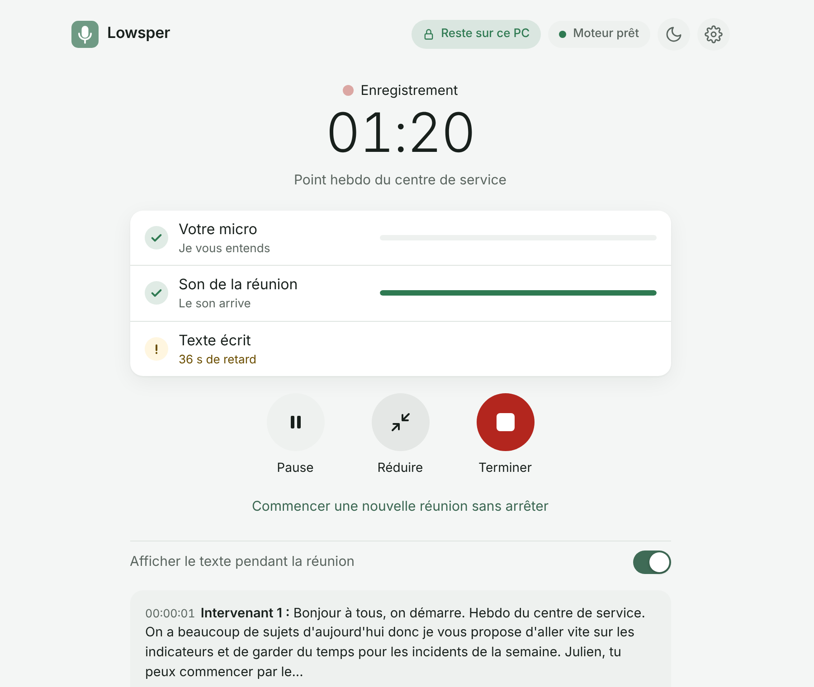
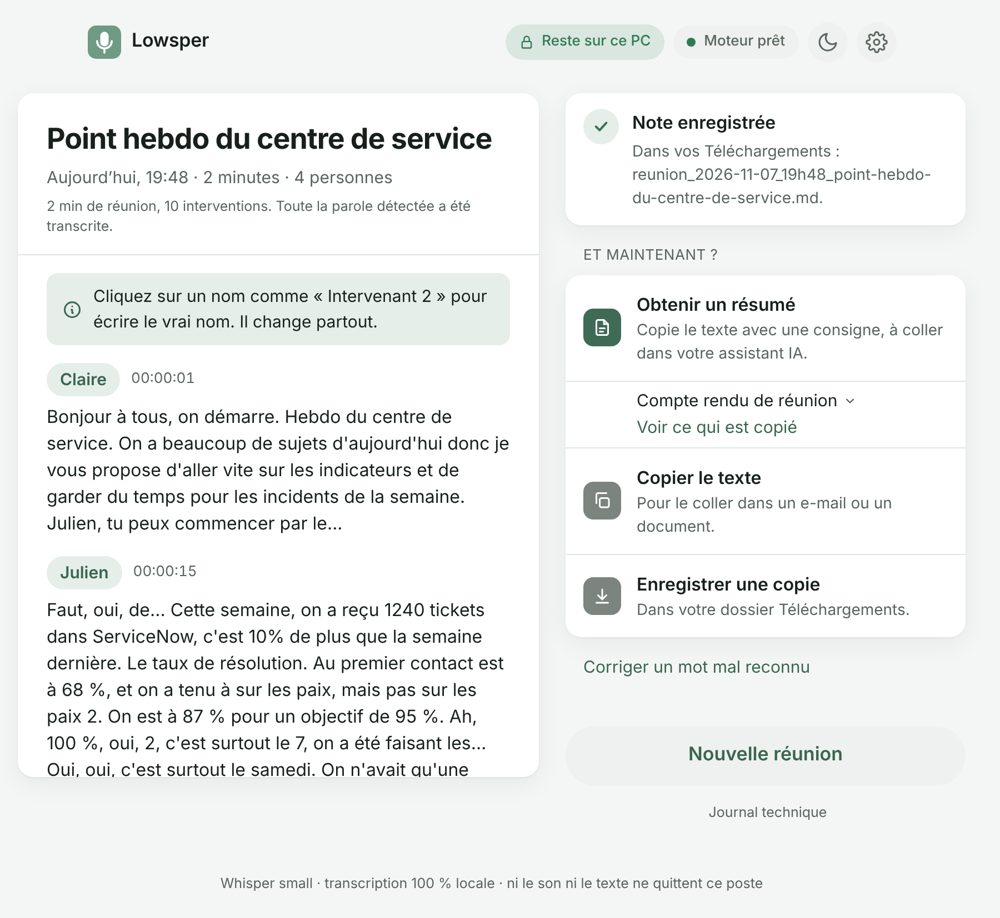

# Lowsper

[English](README.md) | **Français**

[](https://github.com/PercyaDJ/Lowsper/actions/workflows/ci.yml)
[](LICENSE)
[](https://github.com/PercyaDJ/Lowsper/releases/latest)

**Transcription de réunions qui reste sur votre ordinateur, dans le navigateur, sans rien installer.**
Lowsper capte votre micro et le son de la réunion (Teams, Zoom, Meet...), transcrit en direct avec
Whisper, distingue les intervenants, et vous donne une note Markdown horodatée, prête à être
confiée à une IA pour le compte rendu. Ni le son ni le texte ne quittent l'ordinateur.



## Pourquoi Lowsper

- **Rien à installer.** Un fichier HTML ouvert dans Edge ou Chrome : ni exécutable, ni droits
  d'administrateur, ni serveur. Il fonctionne sur les postes d'entreprise verrouillés.
- **Confidentiel par construction.** Tout est calculé sur le poste. La page bloque toute connexion
  sauf le téléchargement initial du modèle depuis Hugging Face, et un test automatique le vérifie
  à chaque modification ([SECURITY.md](SECURITY.md)). Le son n'est jamais écrit sur le disque.
- **Pensé pour les réunions.** Votre micro et les autres participants, intervenants distingués,
  vos mots et sigles, une petite fenêtre toujours visible, des réunions enchaînées, et aucune
  parole perdue en silence.

## Démarrage rapide

1. Téléchargez `Lowsper-X.Y.Z.zip` depuis la [dernière version](https://github.com/PercyaDJ/Lowsper/releases/latest)
   et dézippez-le (clic droit, « Extraire tout »).
2. Ouvrez `Lowsper.html` dans Edge ou Chrome.
3. Premier lancement seulement : Lowsper montre ce qu'il a détecté sur votre PC et coche le
   meilleur modèle. Cliquez sur « Télécharger et installer » et choisissez le dossier Lowsper
   affiché (ou celui qui le contient). Le modèle (80 à 330 Mo) se télécharge une seule fois ; ensuite tout fonctionne hors
   ligne.
4. Sur l'accueil, nommez la réunion, choisissez où enregistrer la note, cliquez sur « Démarrer ».
   Partagez votre écran **avec le son** et autorisez le micro.
5. Cliquez sur « Terminer ». La note est enregistrée dans `Notes\<emplacement>`, dans le dossier
   Lowsper. Nommez les intervenants sur leurs répliques, puis « Obtenir un résumé » copie une
   consigne prête et la note pour l'assistant d'IA de votre choix.



## Ce que fait Lowsper

- **Transcription en direct** du micro et du son partagé de la réunion, intervenants distingués.
- **Compte rendu en haut de la note** : les phrases prononcées qui portent une décision, une action
  ou une question ouverte, recopiées mot pour mot avec l'heure et la personne ; rien n'est réécrit.
  Sur des réunions fictives jamais utilisées pour le réglage, transcrites par Lowsper lui-même,
  la moitié de ces phrases sont retrouvées en français, sept sur dix en anglais ; huit sur dix des
  phrases recopiées sont justes.
- **Notes rapides** tapées pendant la réunion, reprises dans la note avec l'heure où vous avez
  commencé à les taper. « Obtenir un résumé » propose aussi un **e-mail de suivi** pour les
  participants.
- **Mots à reconnaître** (noms, sigles) et **corrections automatiques** des mots mal compris,
  gardés d'une réunion à l'autre ; treize vocabulaires métier intégrés, dont « IA et informatique », en français et en anglais.
- **Emplacements** : chacun est un dossier et un format de note. « Pour les applications de
  notes » ajoute des propriétés et des liens `[[Nom]]` lisibles par des applications comme
  Obsidian.
- **Fichiers audio** (WAV, MP3, M4A, OGG, WebM), même de plusieurs heures, avec le même moteur.
- **Paramètres** en trois onglets, gardés dans le dossier Lowsper ; export et import pour les
  déplacer vers un autre PC.
- **Langues parlées** : cochez celles de vos réunions (français, anglais, espagnol, allemand,
  portugais, néerlandais, arabe, japonais ; mandarin, italien et coréen moins fiables), Lowsper
  reconnaît celle de chaque passage. **Interface en français ou en anglais**, selon le
  navigateur.

## Bon à savoir

- **Navigateurs** : Edge et Chrome. Brave après un réglage. Firefox : micro seul, avec un modèle
  déjà installé.
- **Qualité** : le son compressé d'une visio est plus difficile pour Whisper que votre micro ; un
  casque aide. Pendant une parole simultanée, une seule voix est retenue.
- **Mise à jour** : copiez `app\models`, `app\reglages.txt` et le dossier `Notes` de l'ancienne
  version vers la nouvelle : rien n'est perdu.

## Pour aller plus loin

- [Guide complet](docs/guide.md) : chaque écran, questions fréquentes, limites connues.
- [Guide de déploiement pour les DSI et RSSI](docs/deploiement.md), [SECURITY.md](SECURITY.md).
- [CHANGELOG.md](CHANGELOG.md), [decision.md](decision.md) (choix techniques et mesures).

## Pour les développeurs

```bash
cd tools
npm ci --ignore-scripts && node node_modules/esbuild/install.js
npm run fetch-all   # modèles à la révision figée de models.lock.json, empreintes vérifiées
npm run build       # moteur et catalogue, identiques à l'octet près au dépôt
npm test            # ce que lance la CI : lint, tests unitaires, paquet, non-fuite réseau, navigateur
```

Règles, commandes et carte du dépôt : [AGENTS.md](AGENTS.md). Contribuer :
[CONTRIBUTING.md](CONTRIBUTING.md). Architecture : [docs/architecture.md](docs/architecture.md).

## Licences

Code Lowsper : MIT. Whisper (OpenAI) : MIT. transformers.js : Apache 2.0. ONNX Runtime Web : MIT.
Silero VAD : MIT. WeSpeaker ResNet34 : CC BY 4.0. Textes complets dans `app/engine/THIRD_PARTY_LICENSES.txt`.
