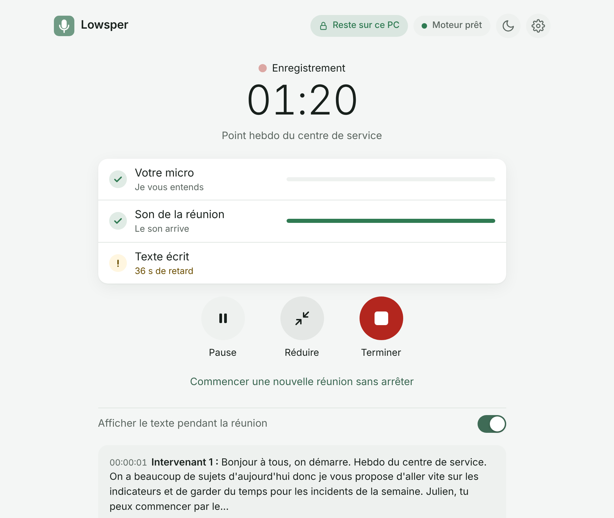
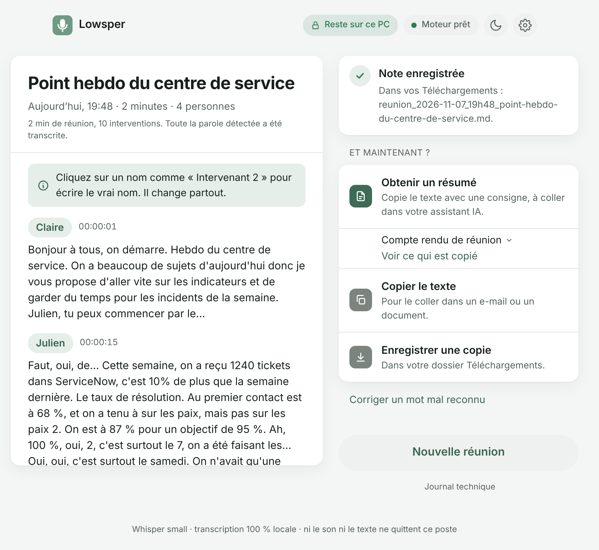

# Lowsper

**English** | [Français](README.fr.md)

[](https://github.com/PercyaDJ/Lowsper/actions/workflows/ci.yml)
[](LICENSE)
[](https://github.com/PercyaDJ/Lowsper/releases/latest)

**Meeting transcription that stays on your computer, in your browser, with nothing to install.**
Lowsper listens to your microphone and to the meeting sound (Teams, Zoom, Meet...), transcribes
live with Whisper, tells speakers apart, and gives you a timestamped Markdown note, ready to hand
to an AI for the minutes. Neither the sound nor the text leaves the computer.



## Why Lowsper

- **Nothing to install.** One HTML file opened in Edge or Chrome: no executable, no admin rights,
  no server. It works on locked-down work laptops.
- **Private by design.** Everything runs on the PC. The page blocks every network connection except
  the one-time model download from Hugging Face, and an automated test checks it on every change
  ([SECURITY.md](SECURITY.md)). Audio is never written to disk.
- **Built for meetings.** Your microphone and the other participants, speakers told apart, your
  own words and acronyms, a small always-visible window, back-to-back meetings, and no speech
  silently lost.

## Quick start

1. Download `Lowsper-X.Y.Z.zip` from the [latest release](https://github.com/PercyaDJ/Lowsper/releases/latest)
   and unzip it (right click, « Extract all »).
2. Open `Lowsper.html` in Edge or Chrome.
3. First launch only: Lowsper shows what it found on your PC and ticks the best model for it.
   Click « Download and install » and select the Lowsper folder shown on screen. The model (80 to
   330 MB) is downloaded once; then everything works offline.
4. On the home screen, name the meeting, choose where to save the note, click « Start ». Share
   your screen **with audio** and allow the microphone.
5. Click « Stop ». The note is saved in `Notes/<place>` inside the Lowsper folder. Name the
   speakers on their lines, then « Get a summary » copies ready-made instructions and the note for
   the AI assistant of your choice.



## What it does

- **Live transcription** of your microphone and of the shared meeting sound, speakers told apart.
- **Words to recognize** (names, acronyms) and **automatic fixes** for misheard words, kept from
  one meeting to the next; twelve built-in industry vocabularies, in English and French.
- **Places**: each one is a folder and a note format. « For note apps » adds properties and
  `[[Name]]` links readable by apps like Obsidian.
- **Audio files** (WAV, MP3, M4A, OGG, WebM), even several hours long, with the same engine.
- **Settings** in three tabs, saved in the Lowsper folder; export and import to move them to
  another PC.
- **Spoken languages**: tick those of your meetings (French, English, Spanish, German,
  Portuguese, Dutch, Arabic, Japanese; Mandarin, Italian and Korean less reliable), Lowsper
  recognizes the one used in each passage. **Interface in English or French**, following the
  browser.

## Good to know

- **Browsers**: Edge and Chrome. Brave after one setting. Firefox: microphone only, with a model
  already installed.
- **Accuracy**: compressed video-call sound is harder for Whisper than your microphone; a headset
  helps. Overlapping speech keeps one voice.
- **Updating**: copy `app/models`, `app/reglages.txt` and the `Notes` folder from the old version
  to the new one: nothing is lost.

## Learn more

- [Full guide, in French](docs/guide.md): every screen, FAQ, known limits.
- [Deployment guide for IT and security teams](docs/deploiement.md), [SECURITY.md](SECURITY.md).
- [CHANGELOG.md](CHANGELOG.md), [decision.md](decision.md) (technical choices and measurements).

## For developers

```bash
cd tools
npm ci --ignore-scripts && node node_modules/esbuild/install.js
npm run fetch-all   # models at the revision pinned in models.lock.json, hashes checked
npm run build       # engine and catalog, byte-identical to the repository
npm test            # what CI runs: lint, unit tests, package, no network leak, browser tests
```

Rules, commands and repository map: [AGENTS.md](AGENTS.md). How to contribute:
[CONTRIBUTING.md](CONTRIBUTING.md). Architecture: [docs/architecture.md](docs/architecture.md).

## Licences

Lowsper code: MIT. Whisper (OpenAI): MIT. transformers.js: Apache 2.0. ONNX Runtime Web: MIT.
Silero VAD: MIT. WeSpeaker ResNet34: CC BY 4.0. Full texts in `app/engine/THIRD_PARTY_LICENSES.txt`.
