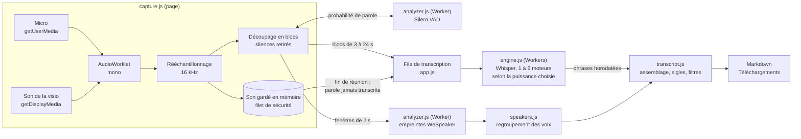

# Architecture de Lowsper

Ce document permet de s'y retrouver dans le code en dix minutes. Les choix, leurs alternatives et
les mesures sont dans [decision.md](../decision.md) ; les règles de contribution dans
[AGENTS.md](../AGENTS.md).

## Contrainte de départ : une page ouverte depuis le disque

Lowsper est une page HTML ouverte en double-clic (`file://`), sans serveur ni installation. Le
navigateur y interdit `fetch` vers les fichiers voisins, les modules ES, et les Workers chargés
depuis un fichier. Conséquences visibles partout dans le code (decision.md §2) :

- tout est livré en **scripts classiques**, chacun dans une fonction auto-exécutée qui étend
  `window.Lowsper` ;
- les binaires (WebAssembly, modèles) sont **emballés en base64** dans des fichiers `.js` ou `.txt`
  chargés par des balises `<script>` ;
- les **Workers** sont construits en mémoire, à partir d'un `Blob` contenant le texte de leur code.

Analogie : plutôt que d'aller chercher ses ingrédients au marché (le réseau), la page a tout dans
son garde-manger (le dossier), étiqueté pour pouvoir l'ouvrir sans clé.

## Le trajet du son, du micro au Markdown

1. **Capture** (`capture.js`). Le micro (« Vous ») et le son du partage d'écran (« Participants »)
   passent chacun dans un AudioWorklet, sont ramenés en mono 16 kHz, puis gardés en mémoire
   (jamais sur le disque) pour le rattrapage de fin de réunion.
2. **Découpage** (`Segmenter`). Silero VAD (dans un Worker dédié, jamais bloquant) dit où est la
   parole. Les silences sont retirés et la parole est regroupée en blocs : Whisper paie toujours une
   fenêtre de 30 s, autant la remplir. Chaque bloc garde une table pour retrouver l'heure réelle de
   chaque phrase.
3. **File et moteurs** (`app.js`). Les blocs attendent dans une file ; un ou plusieurs moteurs
   Whisper (un cœur chacun) les prennent. Un moteur en échec est remplacé, le passage relancé ; un
   passage qui attend trop part par une « voie rapide » (Whisper base), puis est retranscrit
   précisément (decision.md §15.12, §15.18).
4. **Transcription** (`engine.js`). Dans le Worker : contexte (nom de la réunion, vocabulaire,
   glossaire) ajusté à la fenêtre de 448 jetons (`decodePlan`), détection des boucles, reprise si
   Whisper s'arrête trop tôt.
5. **Intervenants** (`analyzer.js`, `speakers.js`). Des empreintes vocales sur des fenêtres de 2 s
   sont regroupées en voix ; en direct d'abord, puis par un regroupement complet à la fin. La voix
   du micro sert à reconnaître l'écho des haut-parleurs.
6. **Assemblage** (`transcript.js`, `vocabulary.js`). Phrases replacées dans le temps, sigles
   recollés, casse du glossaire, hallucinations et répétitions filtrées, corrections apprises,
   puis Markdown. Une copie de secours du texte est gardée dans le navigateur.
7. **Fin de réunion**. Les derniers blocs sont transcrits, le son gardé en mémoire est relu pour
   rattraper la parole qui aurait échappé au direct, les voix sont regroupées, l'écho retiré, et la
   couverture calculée.

## Fichiers importés

Un enregistrement fait ailleurs suit la même chaîne, à partir du découpage :
`audiofile.js` lit le conteneur (WAV, MP3, AAC, M4A, Ogg, WebM), confie les trames au décodeur du
navigateur (WebCodecs) par petits lots et livre du son 16 kHz mono au découpage, comme le ferait
un micro. Le décodage s'interrompt dès que la file de transcription s'allonge : la mémoire reste
bornée, même pour plusieurs heures. La détection de parole n'y a pas de délai, la voie rapide et
le rattrapage ne servent pas (decision.md §19).

## Ce qui touche au disque et au réseau

| Module | Disque | Réseau |
|---|---|---|
| `installer.js` | Écrit les modèles dans `app/models/` (dossier choisi par l'utilisateur) | **Seul code réseau** : téléchargement depuis Hugging Face, révision figée, empreinte SHA-256 vérifiée |
| `settings.js` | Écrit `app/reglages.txt` (réglages, jamais de texte de réunion) | Aucun |
| `app.js` | Le transcript, par un téléchargement que le navigateur range dans Téléchargements | Aucun |
| Tous les autres | Aucun | Aucun |

La politique de sécurité de `Lowsper.html` interdit tout le reste, et `tools/test/csp.mjs` le
vérifie à chaque pull request.

## Où modifier quoi

| Je veux... | Fichier |
|---|---|
| Changer le découpage de la parole, la capture | `app/js/capture.js` |
| Lire un nouveau format de fichier | `app/js/audiofile.js` |
| Changer le décodage Whisper, le contexte, les relances internes | `app/js/engine.js` |
| Changer la file, les moteurs, l'interface | `app/js/app.js`, `Lowsper.html`, `app/css/lowsper.css` |
| Changer le Markdown, les filtres, les sigles | `app/js/transcript.js` |
| Ajouter un vocabulaire métier | `app/js/vocabulary.js` |
| Changer la distinction des voix | `app/js/speakers.js` |
| Ajouter ou mettre à jour un modèle | `tools/models.mjs`, `tools/models.lock.json`, puis `npm run build` |

## Tests

| Test | Ce qu'il couvre | Durée |
|---|---|---|
| `tools/test/unit.mjs` | Découpage, assemblage, filtres, voix, couverture, budget de jetons (Node seul) | 16 s |
| `tools/test/csp.mjs` | Non-fuite réseau : politique, code, navigateur | 15 s |
| `tools/test/import.mjs` | Décodage des fichiers importés, 7 formats ; `--long` : 3 h et mémoire | 10 s, 10 min |
| `tools/test/e2e-import.mjs` | Import dans la vraie page : file, en-tête, voix, échec, annulation | 3 min |
| `tools/test/release.mjs` | Contenu et reproductibilité du paquet de distribution | 1 s |
| `tools/test/e2e.mjs` | Installation, réunion simulée, panne de moteur, enchaînement, non-fuite | 4 min |
| `tools/test/eval*.mjs`, `soak.mjs`, `bench.mjs` | Mesures : qualité, endurance, vitesse | 5 min à 1 h |
