# Lowsper : guide complet

Version courte : [README.fr.md](../README.fr.md) (français), [README.md](../README.md) (English).

[](https://github.com/PercyaDJ/Lowsper/actions/workflows/ci.yml)
[](../LICENSE)
[](https://github.com/PercyaDJ/Lowsper/releases/latest)

**Transcription de réunions 100 % locale, dans le navigateur, sans rien installer.**
Lowsper capte votre micro et le son de la réunion (Teams, Zoom, Meet...), transcrit en direct avec
Whisper, distingue les intervenants, et vous donne à la fin un transcript Markdown horodaté, prêt à
être confié à une IA pour rédiger le compte rendu. Ni le son ni le texte ne quittent l'ordinateur.

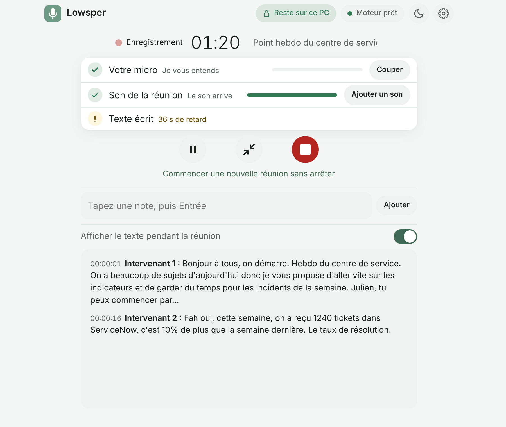

## Pour qui, pour quoi

- **Vous prenez des notes en réunion** et préférez écouter : Lowsper écrit, vous gardez le fil.
- **Vous travaillez sur un poste d'entreprise** où l'on ne peut rien installer : Lowsper est un
  simple fichier HTML ouvert dans Edge ou Chrome, sans exécutable, sans droits d'administrateur.
- **Vos réunions sont confidentielles** : tout est calculé sur le poste. La page interdit
  techniquement toute connexion, sauf le téléchargement initial du modèle (voir
  [SECURITY.md](../SECURITY.md)).

Ce que Lowsper fait :
- transcription **en direct** du micro (« Vous ») et du son partagé de la visio (« Participants ») ;
- **intervenants distingués** automatiquement (Intervenant 1, 2, 3...), renommables à la fin ;
- **glossaire** et **vocabulaires métier** pour bien écrire vos sigles et noms propres, corrections
  de mots retenues d'une réunion à l'autre ;
- **emplacements** : la note arrive dans `Lowsper\Notes`, ou directement dans votre base de notes
  (type Obsidian) avec ses propriétés et ses liens `[[Nom]]`, un emplacement par usage ;
- **mini-fenêtre** toujours visible pendant la visio, **réunions enchaînées** sans temps mort ;
- **import de fichiers audio** (dictaphone, téléphone, enregistrement fait ailleurs), même de
  plusieurs heures, avec le même moteur que le direct ;
- **rien n'est perdu en silence** : passage en échec relancé, parole manquée rattrapée en fin de
  réunion, couverture indiquée en tête du transcript.

## Pourquoi Lowsper plutôt qu'un autre outil

| | Services de transcription en ligne | Applications de dictée locales | **Lowsper** |
|---|---|---|---|
| Où part le son | Sur les serveurs du service | Reste sur le poste | **Reste sur le poste** |
| Installation | Compte, parfois extension ou application | Exécutable à installer | **Aucune : un fichier HTML** |
| Son de la visio (les autres participants) | Oui, souvent via un robot invité | Généralement micro seul | **Oui, via le partage d'écran** |
| Intervenants, horodatage, Markdown | Variable | Rarement | **Oui** |
| Poste d'entreprise verrouillé | Souvent bloqué par la politique de sécurité | Souvent bloqué (exécutable) | **Fonctionne dans Edge ou Chrome** |

Lowsper n'est pas un outil de dictée (il n'écrit pas dans vos applications) : c'est un greffier de
réunion qui travaille hors ligne.

## Installation et utilisation

1. **Téléchargez** la dernière version : page [Releases](https://github.com/PercyaDJ/Lowsper/releases/latest),
   fichier `Lowsper-X.Y.Z.zip` (environ 23 Mo ; son empreinte SHA-256 est publiée à côté).
   **Dézippez-le** où vous voulez (clic droit, « Extraire tout »), par exemple dans Documents.
2. **Double-cliquez sur `Lowsper.html`**. Il s'ouvre dans votre navigateur (Edge ou Chrome).
   Si un autre navigateur s'ouvre : clic droit sur le fichier, « Ouvrir avec », Microsoft Edge.
3. **Premier lancement uniquement** : l'écran de bienvenue montre ce que Lowsper a détecté sur
   votre PC (processeurs, mémoire, carte graphique) et coche le modèle **« Le meilleur pour ce
   PC »**. Cliquez sur **« Télécharger et installer »**. La fenêtre du navigateur s'ouvre sur vos
   Téléchargements : choisissez le **dossier Lowsper** affiché à l'écran (celui qui contient
   `Lowsper.html`) et acceptez que Lowsper y enregistre des fichiers. Depuis la 4.5.0, le zip
   contient directement les fichiers : « Extraire tout » donne un seul dossier `Lowsper-X.Y.Z`
   (avec une version plus ancienne, deux dossiers du même nom l'un dans l'autre : choisir le
   premier suffit, Lowsper retrouve seul celui qui contient `Lowsper.html`). Le téléchargement (80 à 330 Mo selon le modèle)
   prend une à quelques minutes, la page redémarre toute seule à la fin. Ce même accord sert
   ensuite à garder une copie de vos réglages dans ce dossier, et à y ranger vos notes
   (`Notes\<emplacement>`).

   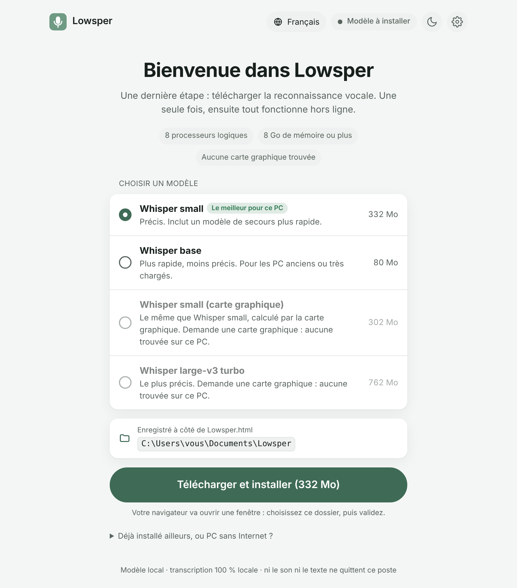
4. Dans les **paramètres** (roue crantée en haut à droite), onglet **Transcription** : ouvrez
   **« Langues parlées dans mes réunions »** et cochez chaque langue de vos réunions, puis
   **« Vocabulaire métier »** et cochez votre domaine (santé, juridique, finance, informatique...),
   puis **« Mots à reconnaître »** et entrez une fois pour toutes les sigles et noms de vos réunions
   (ex. `Ombrelune, projet Atlas, Mme Durand`). Tout est mémorisé, et copié dans le dossier Lowsper
   pour survivre à un nettoyage du navigateur. Donnez aussi un **nom à chaque réunion** (« Entretien
   Ombrelune ») : Lowsper le fournit au moteur, les noms propres qu'il contient sont alors bien
   écrits.

   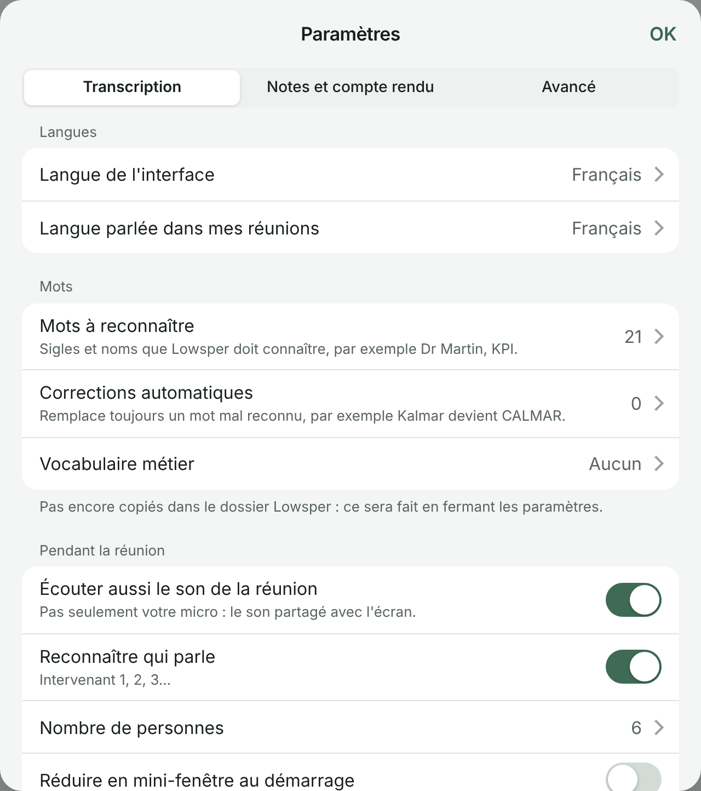
5. Sur l'**accueil**, donnez un **nom** à la réunion (facultatif) et choisissez où **enregistrer
   la note** (menu des emplacements, avec leur dossier ; « Nouvel emplacement… » en crée un). Cliquez sur **« Démarrer »**.

   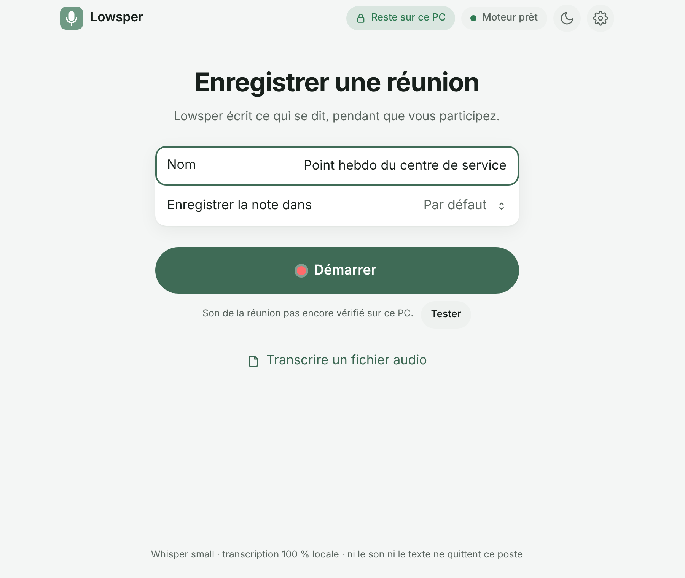
6. La fenêtre **« Avant de commencer »** rappelle les trois étapes ; cliquez sur **« Continuer »** :
   - **prévenez les participants** que la réunion est transcrite ;
   - le navigateur propose un **partage d'écran**. **Windows 11** : la fenêtre s'ouvre sur l'écran
     entier ; cochez le son. Lowsper prend le son de toutes les applications (Teams, Jabber,
     lecteur vidéo, autre navigateur), quel que soit le casque, sans message d'erreur ; seul le son
     du navigateur de Lowsper n'est pas compris (voir « Ajouter un onglet » plus bas). **Autres
     systèmes** : visio dans le navigateur (Teams, Meet, Webex en ligne...), choisissez
     l'**onglet de la visio** et cochez **« Partager l'audio de l'onglet »** ; visio dans une
     application, choisissez l'**écran entier** et cochez **« Partager aussi le son du
     système »**. Seul le son est utilisé, rien n'est filmé ;
   - autorisez le **micro**.
   Pour les habitués, « Ne plus afficher » supprime cette fenêtre.

   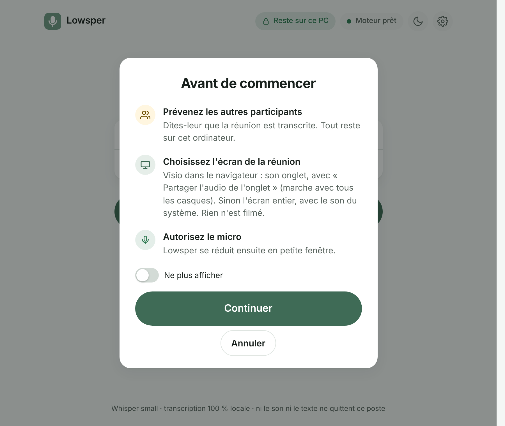
   Lowsper se réduit aussitôt en **mini-fenêtre** : une petite barre toujours visible (durée,
   niveau du micro et du son de la réunion, pause, fin), comme un appel réduit. Si le son de la
   réunion n'arrive pas, son icône devient orange ; le survol explique quoi faire.

   

   La **fenêtre de Lowsper** (bouton « Réduire » pour revenir à la mini-fenêtre) tient sans
   défiler, même sur un portable : chronomètre, nom de la réunion (modifiable) et un **contrôle
   d'état** en langage simple :
   - **votre micro** : « Je vous entends ». Le bouton **« Couper »** coupe votre micro, comme
     dans la visio : votre voix n'est plus transcrite, ni pendant ni après la réunion, jusqu'à
     « Rétablir ». Dans la mini-fenêtre, cliquez sur l'icône du micro (barrée quand il est
     coupé). Le son de la réunion, lui, continue d'être capté ;
   - **le son de la réunion** : « Le son arrive », ou « Rien ne passe » avec un bouton **« Comment
     corriger »** qui permet de partager de nouveau le son ;
   - **le texte écrit** : « À jour », ou le retard en secondes si le PC prend du retard.
   Le texte en direct est masqué par défaut : l'interrupteur « Afficher le texte pendant la
   réunion » l'affiche (choix gardé), dans toute la hauteur qui reste ; c'est lui qui défile, pas
   la fenêtre. Sur un écran bas, les légendes des boutons ronds passent dans leur infobulle. « Commencer une nouvelle réunion sans arrêter » enchaîne
   sur la suivante sans repartager l'écran.

   **Plusieurs sons à la fois** : le bouton de la ligne « Son de la réunion » capte un son de
   plus, en même temps que le premier. Il s'appelle **« Ajouter un onglet »** quand le son de
   toutes les applications est capté (Windows 11) : une visio ou une vidéo dans un onglet du
   navigateur de Lowsper s'ajoute ainsi d'un clic. Sinon, **« Ajouter un son »** capte un onglet
   ou une fenêtre de plus : la visio est dans un onglet et vous présentez une vidéo dans un autre,
   partagez l'onglet de la visio au démarrage, puis ajoutez celui de la vidéo. Arrêter le partage
   de l'un ne coupe pas les autres.

   **Notes rapides** : tapez une note dans le champ « Note rapide », puis Entrée (ou « Ajouter »).
   Elle est reprise dans la note, dans la section « Vos notes », avec l'heure où vous avez
   commencé à la taper : celle du moment dont vous parlez, pas celle où vous avez fini d'écrire.
   « Retirer » l'enlève. Une note tapée sans Entrée au moment de « Terminer » (ou de « Commencer
   une nouvelle réunion sans arrêter ») est gardée dans la réunion qui se termine. Les notes ne
   passent pas par le moteur de transcription et restent sur le PC, comme le texte.

   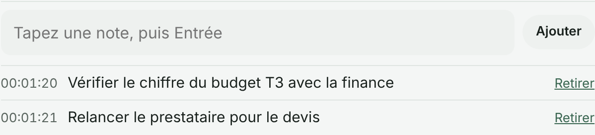
7. En fin de réunion, cliquez sur **« Terminer »** (carré rouge). La note est enregistrée dans le
   dossier de l'emplacement (par défaut `Lowsper\Notes\Par défaut`) : la carte « Note
   enregistrée » dit où. L'écran
   de fin montre le texte de la réunion à gauche, en bulles comme des SMS : ce que vous avez dit
   au micro en vert clair, à droite ; les autres en gris, à gauche. Pour nommer un intervenant, cliquez sur
   son étiquette (« Intervenant 2 ») et tapez son nom : il change sur toutes ses répliques et dans
   la note (Entrée valide, Échap annule). À droite, « Et maintenant ? » :
   - **« Obtenir un résumé »** copie une consigne pour l'IA suivie de la note, à coller dans
     l'assistant de votre choix. La consigne (compte rendu de réunion, synthèse d'appel, liste
     d'actions, e-mail de suivi, ou la vôtre) se choisit juste en dessous, et **« Voir ce qui est
     copié »** montre le texte exact. « E-mail de suivi » demande à l'IA l'e-mail à envoyer aux
     participants : objet, décisions, actions, questions ouvertes, prochaine étape, sans
     signature, avec entre crochets ce qu'il faut vérifier avant l'envoi ;
   - **« Copier le texte »** copie la note seule ;
   - **« Enregistrer une copie »** la télécharge.

   « Corriger un mot mal reconnu » ouvre la correction, et « Nouvelle réunion » ramène à
   l'accueil.

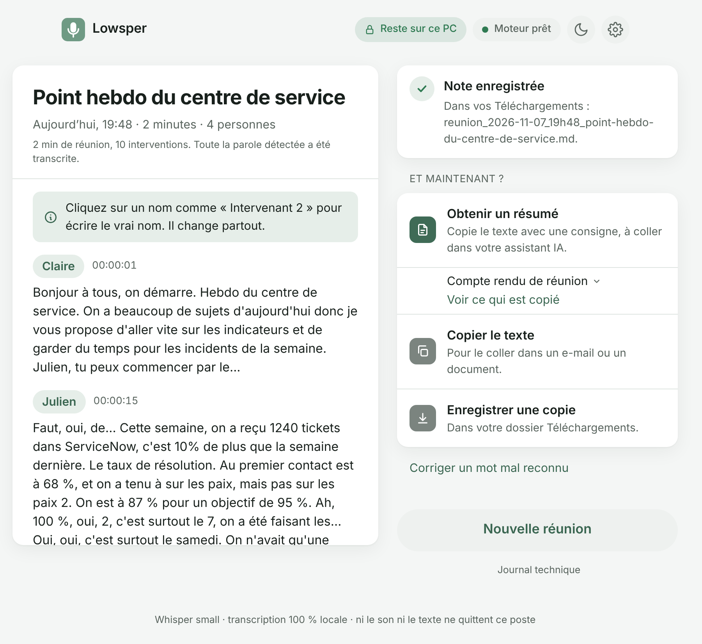

*Captures faites sur une réunion entièrement fictive (voix de synthèse), sur la machine de
développement, lente : l'indicateur « Charge du moteur » y dépasse 100 %. Elles se régénèrent avec
`node tools/test/screenshots.mjs`.*

Conseils :
- Un **casque** donne un meilleur résultat (le micro ne réentend pas les participants). Sans
  casque, Lowsper reconnaît votre voix et retire à la fin les phrases du micro qui sont l'écho des
  haut-parleurs.
- Gardez l'onglet Lowsper ouvert pendant la réunion (il peut être en arrière-plan).
- Si le navigateur se ferme pendant une réunion, le texte déjà transcrit est proposé au lancement suivant.

### Transcrire un enregistrement fait ailleurs

Un dictaphone, un téléphone, une réunion enregistrée par un autre outil : sur l'écran d'accueil,
cliquez sur **« Transcrire un fichier audio »**, ou glissez un ou plusieurs fichiers dans la page.

- Formats : **WAV, MP3, M4A/AAC, OGG/Opus, WebM**, de quelques secondes à plusieurs heures. Les
  autres formats que le navigateur sait lire (FLAC par exemple) sont acceptés jusqu'à 25 Mo.
- Même chaîne que le direct : détection de parole, intervenants distingués, glossaire,
  vocabulaires et corrections retenues. Le réglage « Nombre de personnes » (paramètres) indique le
  nombre de voix de l'enregistrement ; le nom de la réunion vaut pour un fichier seul.
- Une barre indique l'avancement et le temps restant estimé ; « Annuler » arrête proprement.
  Chaque transcript arrive dans le dossier de l'emplacement choisi dès que son fichier est terminé,
  daté du jour de l'enregistrement quand le fichier le précise.
- Le fichier est lu par morceaux depuis son emplacement, jamais copié ni envoyé ; le son décodé
  n'est jamais écrit sur le disque.

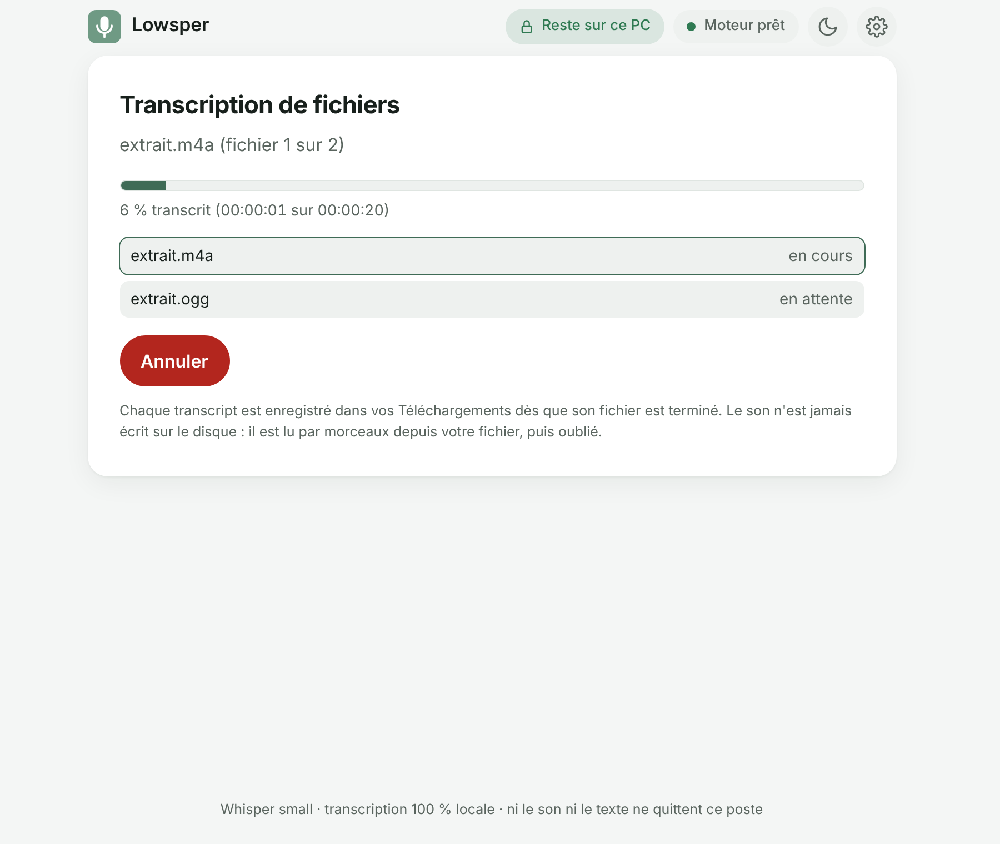

### Où vont les notes : les emplacements

Un **emplacement**, c'est un dossier et un format de note. Créez-en un par usage (« Personnel »,
« Travail »...) dans les paramètres, onglet **Notes et compte rendu**, « Ajouter un emplacement »,
puis choisissez-le sur l'accueil, ligne **« Enregistrer la note dans »**, avant la réunion.

- **Dossier** : par défaut, chaque emplacement a son dossier dans le dossier Lowsper,
  `Notes\<emplacement>` (par exemple `Notes\Par défaut`). Le nom de ce dossier ne change plus
  après la première note, même si vous renommez l'emplacement : vos notes ne se dispersent pas.
  Vous pouvez aussi choisir un autre dossier (par exemple celui de votre base Obsidian).
- **Format de la note** : **« Texte simple »** (le format habituel de Lowsper, lisible partout) ou
  **« Pour les applications de notes »**, qui ajoute :
  - des **propriétés en tête de note** (front matter YAML) : date, durée, intervenants, source,
    modèle, étiquettes et champs libres (`projet: Atlas`) ;
  - des **liens** : les intervenants que vous nommez peuvent être écrits `[[Nom]]` ;
  - un **nom de fichier** à variables, par exemple `{{date}} {{titre}}` (les caractères interdits
    par Windows sont retirés d'office) et un **modèle de note** éditable (`{{titre}}`, `{{date}}`,
    `{{intervenants}}`, `{{transcript}}`... liste complète dans les paramètres).
- Un nom de fichier déjà pris reçoit « (2) » : aucune note n'est écrasée.
- Après la réunion, chaque correction (intervenant nommé, mot corrigé) **met à jour la note** du
  dossier, toute seule.
- L'emplacement **« Par défaut »** garde le format classique de Lowsper (« Texte simple »).

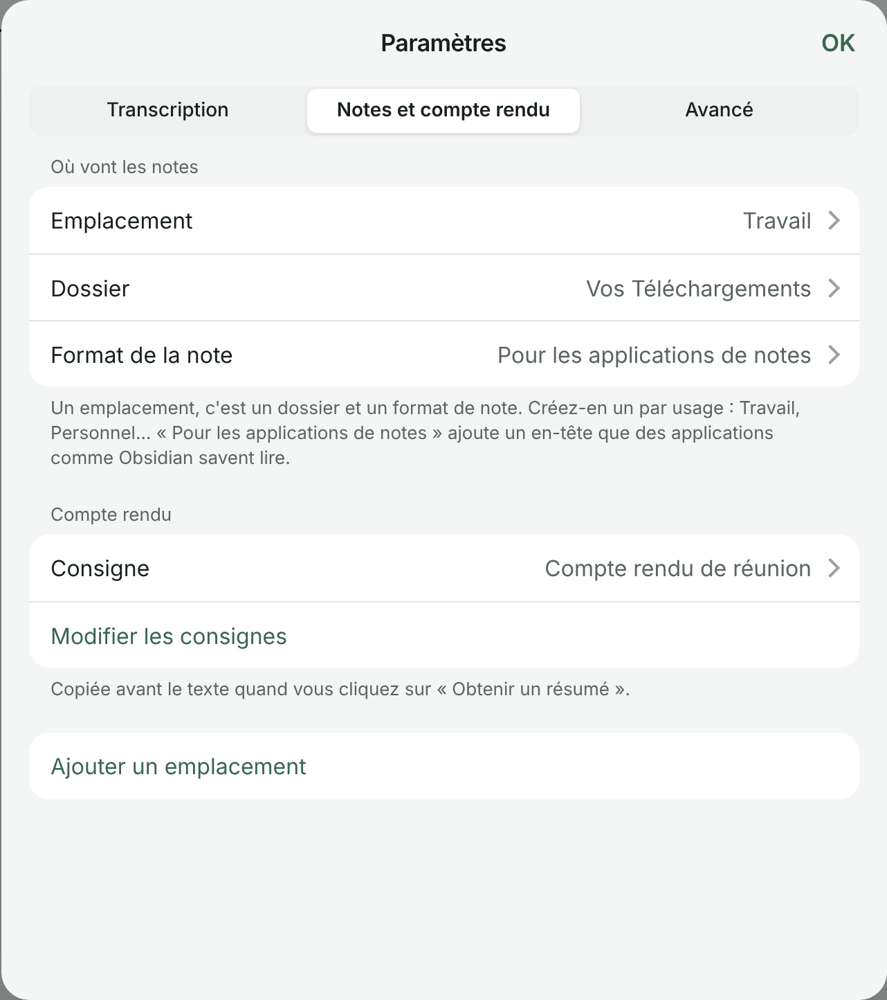

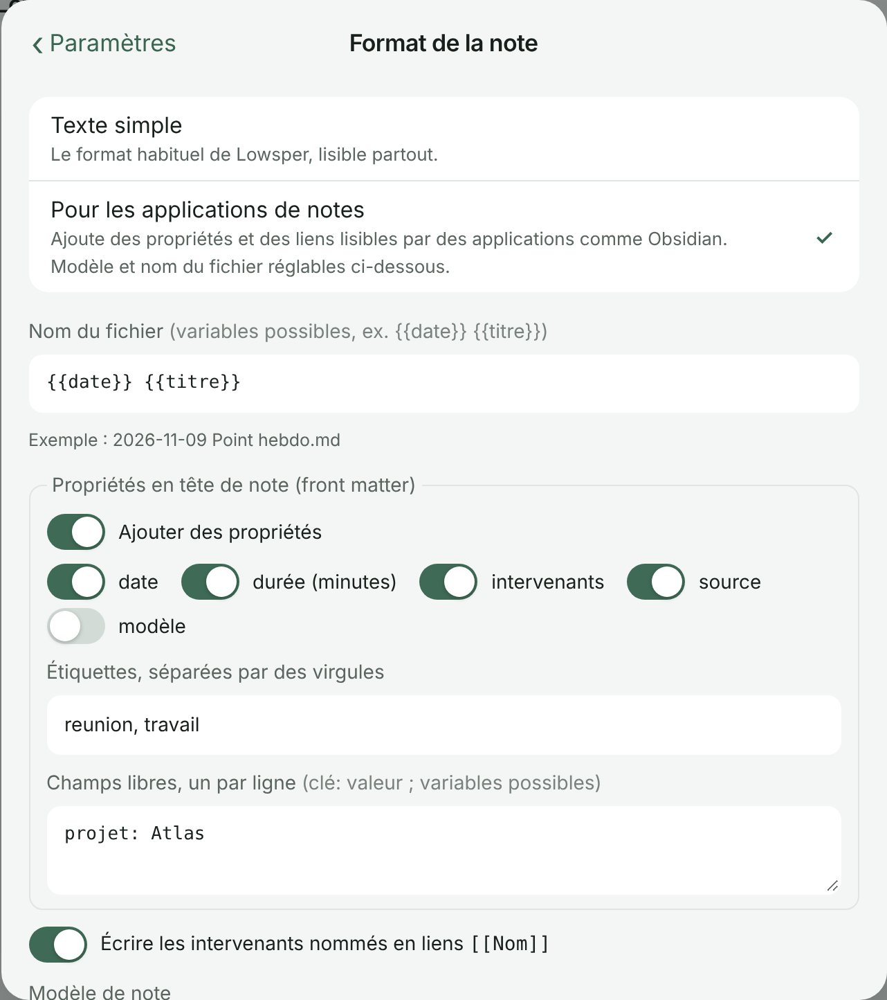

Sans accès au dossier Lowsper (Firefox, ou accord jamais donné au navigateur), la note part dans
vos Téléchargements, comme dans les versions précédentes.

Attention : si ce dossier est synchronisé par un autre outil (stockage en ligne, synchronisation
de votre base de notes), la note quittera l'ordinateur par cet outil. Pour des réunions
confidentielles, choisissez un dossier qui reste sur le poste.

Les emplacements sont conservés avec vos réglages (y compris dans `app\reglages.txt`). L'accès au
dossier, lui, est un accord donné au navigateur : s'il est oublié ou doit être redonné, l'écran
d'accueil le signale et un clic suffit.

### Le compte rendu en haut de la note

À la fin de la réunion (ou de l'import d'un fichier), Lowsper relit le transcript et recopie, en
haut de la note, les phrases qui portent :
- une **décision** (« on garde le tarif actuel », « let's go with the export ») ;
- une **action** (« je relance le fournisseur lundi », « Paul, tu envoies le chiffrage ? ») ;
- une **question restée ouverte** (une question sans réponse, ou « on ne sait pas encore si... »).

Chaque phrase est copiée mot pour mot, avec l'heure et la personne de sa réplique : rien n'est
réécrit, rien n'est inventé. C'est un sommaire pour retrouver vite les moments importants, pas un
compte rendu rédigé : il peut manquer des phrases (la moitié en français, trois sur dix en anglais,
sur des réunions de test), surtout des décisions dites sans formule (« bon, ça me va »), et une phrase peut être mal
rangée. Relisez-le avec le transcript, juste dessous. Les règles existent en français et en
anglais ; dans une autre langue, la section dit qu'aucune phrase n'a été repérée.

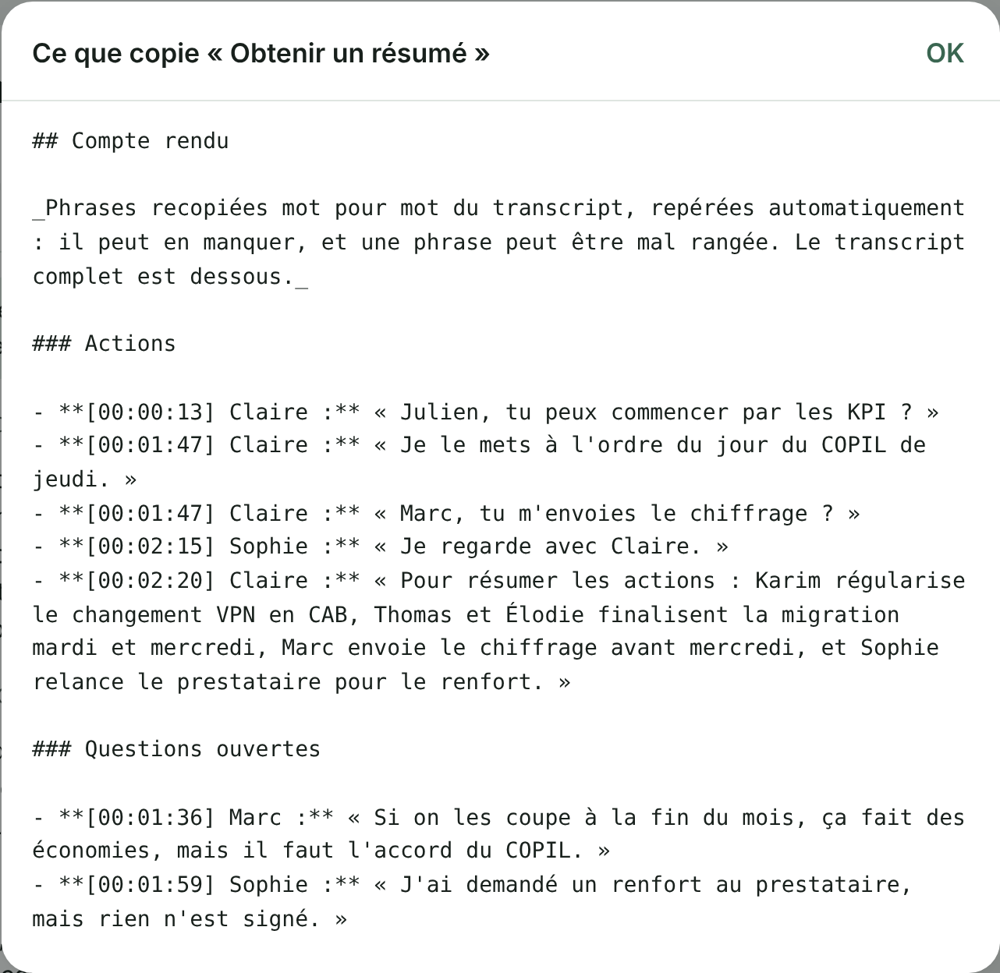

Pour le retirer : Paramètres, « Notes et compte rendu », décochez « Recopier les décisions, actions
et questions en haut de la note » (le réglage vaut à partir de la réunion suivante). Dans un modèle
de note personnalisé, la variable `{{compte_rendu}}` place cette section où vous voulez.

Vos **notes rapides** (tapées pendant la réunion) suivent, dans la section « Vos notes », avant le
transcript. Dans un modèle de note personnalisé, la variable `{{notes}}` les place où vous voulez ;
un modèle modifié avant cette version, sans `{{notes}}`, les reçoit à la fin de la note, pour ne
jamais perdre ce que vous avez tapé.

### Les paramètres

Trois onglets ; chaque élément à choix ouvre un sous-écran (« ‹ Paramètres » ou Échap pour revenir).
- **Transcription** : langue de l'interface, langues parlées, mots à reconnaître, corrections
  automatiques, vocabulaire métier, options de la réunion.
- **Notes et compte rendu** : emplacements, dossier, format de la note, compte rendu en haut de
  la note, consigne de « Obtenir un résumé » et éditeur des consignes.
- **Avancé** : modèle, vitesse, thème, mémoire des voix, sauvegarde, IA intégrée du navigateur
  (expérimental), journal technique.

« Mots à reconnaître » et « Corrections automatiques » sont deux outils différents :

| | Mots à reconnaître | Corrections automatiques |
|---|---|---|
| Quand | **Avant** la transcription | **Après** la transcription |
| Comment | Donnés à Whisper comme contexte : il a plus de chances de les écrire juste | Un mot mal reconnu est remplacé partout par le bon |
| Exemple | `COPIL, Dr Martin, KPI` | `Kalmar` devient `CALMAR` |
| Garantie | Aucune : une aide | Systématique |

**Sauvegarde.** Les réglages s'enregistrent tout seuls. « Exporter les réglages dans un fichier »
et « Importer des réglages depuis un fichier » (onglet Avancé) servent seulement à les déplacer
vers un autre PC. Les voix mémorisées, le modèle et les mesures de vitesse restent sur ce PC ;
l'accès à un dossier choisi est à redonner sur l'autre PC.

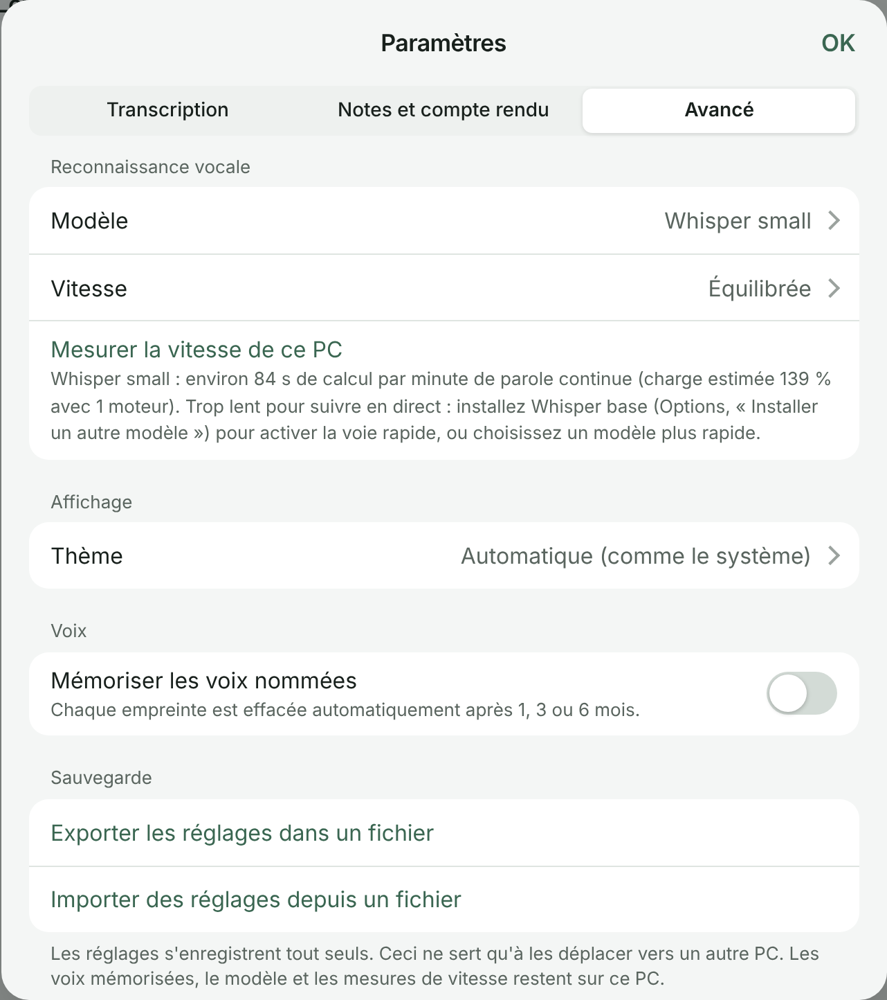

Déploiement sur un parc (DSI, RSSI) : voir [docs/deploiement.md](deploiement.md).

### Langues parlées dans vos réunions

Paramètres, onglet **Transcription**, **« Langues parlées dans mes réunions »** : cochez chaque
langue parlée. Si plusieurs sont cochées, Lowsper reconnaît la langue de chaque passage et la
transcrit dans cette langue (une réunion qui passe du français à l'anglais reste juste). Une seule
langue cochée donne le résultat le plus sûr : ne cochez que celles qui sont vraiment parlées.

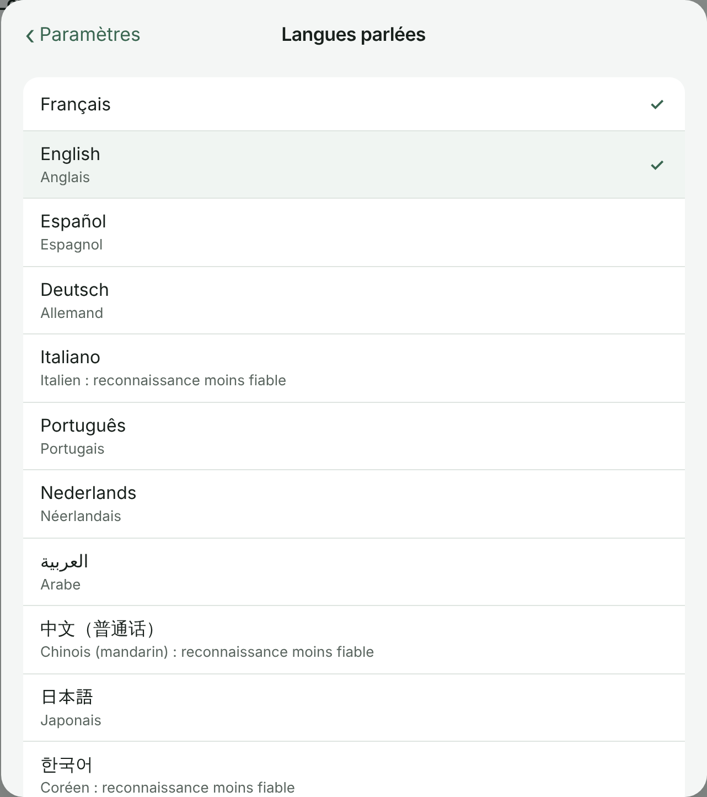

Onze langues sont proposées, après une mesure de la qualité de la reconnaissance (Whisper small,
voix de synthèse, `decision.md` §34) : français, anglais, espagnol, allemand, portugais,
néerlandais, arabe et japonais ; mandarin, italien et coréen portent la mention « reconnaissance
moins fiable » (de 15 à 21 % d'erreurs mesurées, contre 1 à 9 % pour les autres). Le hindi, trop
mal reconnu, n'est pas proposé.

### Vocabulaires métier

Paramètres, onglet **Transcription**, **« Vocabulaire métier »** : treize domaines (cybersécurité,
informatique et cloud, IA et informatique, gestion de projet, santé, juridique, finance et comptabilité, ressources
humaines, éducation, commerce et marketing, secteur public, ingénierie et industrie, immobilier).
Leurs sigles et termes habituels sont donnés à Whisper, dans la langue parlée : chaque domaine a
une liste en français et une en anglais ; pour une autre langue, seuls vos « Mots à reconnaître »
sont donnés.

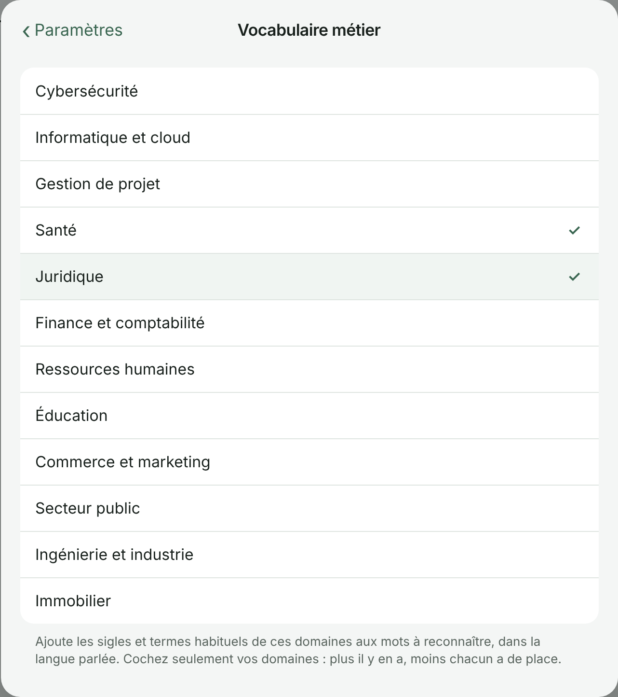

Cochez seulement vos domaines. Whisper ne lit qu'un contexte court (environ quarante sigles) :
avec plusieurs listes, chacune garde ses termes les plus utiles, mais plus il y en a, moins
chacune a de place. Avec une liste, 37 termes métier sur 44 sont bien écrits dans notre mesure ;
avec trois, 35 ; avec les douze, 30, presque comme sans liste (26). Vos « Mots à reconnaître »
passent toujours en priorité. Pour proposer un domaine ou une langue : `CONTRIBUTING.md`.

**IA et informatique** : le jargon des réunions sur l'IA et l'informatique (IA, LLM, carte
graphique, GPU, RAM, prompt, RAG, fine-tuning...) et quelques langages et logiciels libres très
courants (Python, Linux, Git, PostgreSQL, PyTorch), jamais une marque d'éditeur commercial. Dans
notre mesure sur des voix de synthèse, en français, 24 de ces termes sur 31 sont bien écrits avec
la liste, contre 15 sans ; en anglais, Whisper les connaît déjà presque tous (29 sur 31 sans
liste, 30 avec). Les noms de logiciels commerciaux ou propres à votre entreprise s'ajoutent dans
vos « Mots à reconnaître ». Cocher en plus « Informatique et cloud » coûte un ou deux termes sur
31 : cochez les deux si vos réunions mêlent les deux sujets, sinon « IA et informatique » seule.

### Interface en français ou en anglais

Lowsper s'affiche en français si le navigateur est en français, en anglais sinon. Pour changer :
paramètres, onglet **Transcription**, **Langue de l'interface**. Le choix est gardé avec vos
réglages, y compris dans `app\reglages.txt`. La langue se change entre deux réunions, pas pendant.

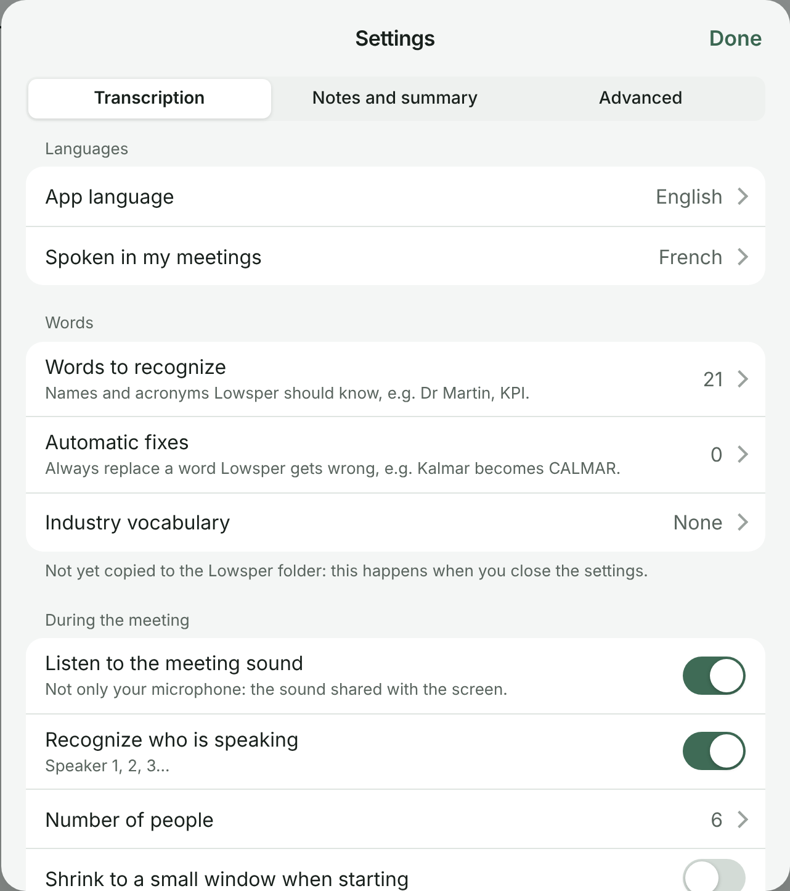

La note suit la langue de l'interface au moment où la réunion commence :
- **en français**, elle est identique à celle des versions précédentes, au caractère près ;
- **en anglais**, son en-tête et ses libellés sont traduits (« Speaker 1 », « You »...) et le
  fichier s'appelle `meeting_...md`.

Dans le format « Pour les applications de notes », les noms des variables (`{{titre}}`, `{{duree}}`...) et les
propriétés écrites en tête de note (`duree:`, `intervenants:`...) restent les mêmes dans les deux
langues : un modèle ou une recherche dans votre base de notes ne casse pas si vous changez de
langue. Les consignes fournies pour « Obtenir un résumé » existent dans les deux langues ; une
consigne que vous avez modifiée n'est jamais changée.

## À quoi ressemble le transcript

```markdown
# Transcript de réunion : Point hebdo du centre de service

- **Date** : jeudi 5 novembre 2026
- **Horaires** : 09:04 à 09:05 (2 min)
- **Sources** : micro (« Vous »), audio partagé (« Participants »)
- **Participants** : 6 personnes (vous compris)
- **Langue** : français
- **Transcription** : Whisper small, exécuté localement par Lowsper (hors ligne)
- **Couverture** : toute la parole détectée a été transcrite
- **Vocabulaire de référence** (sigles et noms propres attendus) : RSSI, SLA, ITSM, ServiceNow, ...

> Transcription automatique : elle peut contenir des erreurs de reconnaissance. [...]

## Compte rendu

_Phrases recopiées mot pour mot du transcript, repérées automatiquement : il peut en manquer, et une phrase peut être mal rangée. Le transcript complet est dessous._

<!-- Extrait réel : corpus hebdo (texte exact), heures de la vérité terrain -->

### Actions

- **[00:01:47] Claire :** « Je le mets à l'ordre du jour du COPIL de jeudi. »
- **[00:01:47] Claire :** « Marc, tu m'envoies le chiffrage ? »
- [...]

### Questions ouvertes

- **[00:01:59] Sophie :** « J'ai demandé un renfort au prestataire, mais rien n'est signé. »
- [...]

## Vos notes

_Notes tapées pendant la réunion, recopiées telles quelles, avec l’heure où vous avez commencé à les écrire._

- **[00:00:20]** Vérifier le chiffre des tickets avec Julien
- [...]

## Transcript

**[00:00:01] Claire :** Bonjour à tous, on démarre l'hebdo du centre de service. [...]

**[00:00:15] Julien :** Cette semaine, on a reçu 1240 tickets dans ServiceNow. [...]
```

## Questions fréquentes

**Lowsper s'affiche en anglais alors que je le veux en français (ou l'inverse).**
Lowsper prend la langue du navigateur. Ouvrez les paramètres (roue crantée), onglet
« Transcription », et choisissez la langue de l'interface. Les langues des réunions, elles, se
règlent à part : « Langues parlées dans mes réunions ».

**Ma réunion en anglais a été transcrite en français (version 4.0.0).**
C'était un défaut de la 4.0.0 : la langue parlée choisie n'était plus prise en compte, et la note
indiquait « Langue : undefined ». Corrigé en 4.1.0 ; votre réglage est relu tel quel.

**Plusieurs langues dans la même réunion ?**
Cochez-les toutes dans « Langues parlées dans mes réunions » : Lowsper reconnaît la langue de
chaque passage. Sur des phrases de 3 à 8 secondes, il ne s'est jamais trompé dans notre mesure,
même en choisissant parmi douze langues ; sur un passage très court (« oui »), ce n'est pas mesuré.

**Le navigateur demande l'accès à un dossier « Lowsper-3.4.0 » (ou une autre version) que je n'ai plus.**
Toutes les copies de Lowsper ouvertes depuis le disque partagent la mémoire du navigateur : une
ancienne version y avait rangé l'accès à son dossier. Refusez cette fenêtre. Depuis la 4.2.1,
Lowsper oublie cet accès sans rien demander et n'utilise que le dossier de la page ouverte.

**Lowsper me dit que le dossier choisi ne contient pas Lowsper.html.**
Choisissez le dossier affiché sur l'écran de bienvenue, ou l'un des dossiers qui le contiennent
(avant la 4.5.0, par exemple le premier des deux dossiers `Lowsper-4.2.1` créés par « Extraire
tout ») : Lowsper
regarde dans les dossiers qu'il contient. Le navigateur ne permet pas d'ouvrir sa fenêtre
directement sur le bon dossier : elle s'ouvre sur vos Téléchargements.

**Le téléchargement du modèle échoue au bureau.**
Le réseau de l'entreprise bloque peut-être Hugging Face. Faites l'installation depuis un autre
réseau (partage de connexion du téléphone, domicile), ou copiez le dossier Lowsper d'un collègue
qui l'a déjà installé : le modèle est dedans (`app/models`).

**Beaucoup de mots incohérents sur les sigles de mon métier (« l'NSI », « BIOCRM »...).**
Cochez le vocabulaire métier correspondant dans les paramètres et ajoutez vos propres termes au
glossaire : sur notre entretien de test en cybersécurité, les sigles bien écrits passent de 6 à 13
sur 35. Le son d'une visio est compressé : Whisper small y fait nettement plus d'erreurs que sur le
micro. Sur un PC équipé d'une carte graphique, le modèle « large-v3 turbo » est bien plus précis.

**« Son de la réunion : rien ne passe ».**
Lowsper n'a entendu personne dans le son partagé depuis 1 minute (ou le partage s'est arrêté).
Cause la plus fréquente : la case « Partager l'audio » n'était pas cochée, ou ce n'est pas l'écran
ou l'onglet de la visio qui est partagé. Cliquez sur « Comment corriger », puis partagez de
nouveau, avec le son. Si vous présentez seul pendant longtemps, l'alerte peut aussi apparaître :
elle disparaît dès que quelqu'un d'autre parle.

**« Windows n'a pas laissé le navigateur capter le son de tout l'ordinateur (Could not start audio source) ».**
Le son de l'écran entier passe par la sortie son de Windows ; sur certains PC (casques de jeu
en son surround, par exemple), Chrome et Edge n'arrivent pas à l'ouvrir.
- **Windows 11, Chrome, Edge ou Brave récents** : ce message n'apparaît plus. Lowsper demande
  d'emblée le son de chaque application (Teams, Jabber, lecteur vidéo, autre navigateur) au lieu
  de la sortie son, quel que soit le casque. Le son des onglets du navigateur où tourne Lowsper
  n'est pas compris : pour une visio ou une vidéo dans l'un de ces onglets, cliquez sur
  « Ajouter un onglet ». Vérifié sur un PC Windows 11 avec un casque de jeu sans fil en son
  surround, dans Chrome et Brave. Si le message apparaît malgré tout, cliquez sur « Partager le
  son de toutes les applications ».
- **Sinon** (Windows 10, navigateur plus ancien) : cliquez sur **« Partager l'onglet de la
  visio »** et choisissez l'onglet de la visio ou de la vidéo : ce son est pris dans le
  navigateur, avant Windows. Une visio dans une application installée n'a pas d'onglet : sans le
  son de toutes les applications, une page web ne peut pas capter son son.
Le micro, lui, est essayé avec ses réglages, puis sans, puis chacun des autres micros du PC.

**Où régler le nombre de personnes ?**
Dans les paramètres, rubrique « Transcription » : **« Nombre de personnes dans vos réunions »**.
Laissez-le vide (automatique) dans la plupart des cas. C'est un plafond, gardé d'une réunion à
l'autre : s'il est trop bas pour une réunion, des voix différentes sont regroupées sous un même
intervenant.

**La fenêtre « Avant de commencer » a disparu.**
Vous avez coché « Ne plus afficher ». Pour la retrouver : paramètres, rubrique « Transcription »,
**« Afficher « Avant de commencer » avant chaque réunion »**.

**Quel modèle choisir ?**
Celui que l'écran de bienvenue marque **« Le meilleur pour ce PC »** : Lowsper le choisit d'après le
nombre de processeurs et la mémoire, pour que la transcription suive la réunion en direct
(règle et mesures : `decision.md` §26).
- « Whisper small » (330 Mo avec son modèle de secours) : précis ; recommandé à partir de 5
  processeurs logiques et 4 Go de mémoire.
- « Whisper base » (80 Mo) : plus rapide, moins précis ; recommandé en dessous.
- « Whisper small (carte graphique) » et « Whisper large-v3 turbo » (le plus précis, 760 Mo) :
  utilisent la carte graphique ; grisés si le PC n'en a pas de compatible. Jamais recommandés
  d'office : leur vitesse n'a pas encore été mesurée.
Un modèle plus précis n'est pas plus rapide. Pendant la réunion, l'indicateur « Charge du moteur »
doit rester sous 100 % ; sinon, installez un modèle plus rapide (paramètres, onglet Avancé,
« Modèle », « Installer ou ajouter des modèles », un modèle à la fois). Le choix entre les modèles
installés se fait au même endroit.

**Mes sigles et réglages ont disparu après avoir fermé le navigateur.**
Beaucoup de postes d'entreprise effacent les données du navigateur à la fermeture. Lowsper en garde
une copie dans son dossier (`app\reglages.txt`) et la restaure tout seul au lancement suivant.
Il faut avoir autorisé Lowsper une fois à écrire dans le dossier : c'est fait à l'installation du
modèle, sinon à la fermeture des paramètres. La phrase sous « Mots » (onglet Transcription) dit
si la copie est faite.

**Comment déplacer mes réglages vers un autre PC ?**
Paramètres, onglet Avancé, « Exporter les réglages dans un fichier », puis sur l'autre PC
« Importer des réglages depuis un fichier ». Le fichier `lowsper-reglages_AAAA-MM-JJ.json` contient
vos mots, corrections, emplacements, consignes et préférences, mais aucune empreinte vocale.
Importer remplace les réglages du fichier et garde les autres ; Lowsper se recharge.

**Des mots sont mal compris (noms de projets, de clients, sigles maison).**
Whisper ne peut pas connaître votre jargon. À la fin de la réunion, utilisez « Corriger un mot mal
reconnu » : le mot est corrigé partout, et Lowsper retient la correction pour les réunions
suivantes. La liste « À vérifier » propose les noms propres douteux : un clic suffit pour commencer.
Si vous connaissez déjà les déformations, entrez-les à l'avance dans les paramètres
(« Corrections automatiques », ex. `Kalmar` → `CALMAR`).

**J'ai enregistré une réunion avec mon téléphone. Combien de temps pour la transcrire ?**
Lire le fichier est rapide, même pour plusieurs heures : sur notre machine de test, lente, 3 h se
lisent en 20 à 30 s (MP3, M4A) et en moins de 2 min (OGG). C'est la transcription qui prend le
temps : le même calcul qu'en direct, avec le renfort de moteurs de votre réglage de puissance,
puisque le PC n'est pas occupé par une visio. La barre d'avancement affiche une estimation après quelques
secondes ; le test de vitesse des paramètres donne un ordre de grandeur pour votre PC.

**J'utilise Obsidian (ou une autre base de notes en Markdown).**
Créez un emplacement, choisissez comme dossier celui de votre coffre (ou un sous-dossier, comme
`Réunions`), prenez le format « Pour les applications de notes » et cochez les propriétés et les
liens `[[Nom]]` : la note arrive dans le coffre à la fin
de la réunion, avec ses propriétés lisibles par Obsidian, et les intervenants que vous nommez
renvoient vers leurs notes.

**J'ai ouvert Lowsper dans un autre navigateur : mes notes vont ailleurs.**
L'accès au dossier Lowsper est donné à chaque navigateur séparément : c'est une règle de
sécurité des navigateurs, qu'une page web ne peut pas contourner. Dans un navigateur qui n'a pas
encore cet accès, l'accueil affiche **« Choisir le dossier Lowsper »** : un clic, une seule fois,
et les notes reviennent dans le même `Lowsper\Notes\...`, avec les mêmes réglages. Brave
n'écrit pas dans un dossier tant que son option « File System Access API » est désactivée
(`brave://flags`) : l'accueil le dit, et les notes vont alors dans les Téléchargements. Les
réglages, eux, sont relus du dossier Lowsper dans tous les navigateurs, sans rien faire.

**Ma note est partie dans les Téléchargements et pas dans mon dossier.**
Le navigateur demande votre accord pour écrire dans un dossier (le dossier Lowsper ou celui que
vous avez choisi), et ne peut le faire qu'après un clic. Sur l'écran de fin, « Enregistrer aussi dans le dossier » règle la question ; pour l'éviter,
cliquez sur « Autoriser maintenant » sur l'écran d'accueil avant la réunion. Si le navigateur a
effacé ses données (fréquent sur un poste d'entreprise), il faut désigner le dossier à nouveau.

**Comment obtenir un compte rendu ?**
Sur l'écran de fin, cliquez sur « Obtenir un résumé », puis collez dans l'assistant d'IA autorisé
par votre entreprise. Trois consignes sont fournies (compte rendu de réunion, synthèse d'appel,
liste d'actions), écrites comme un prompt système : rôle, contexte, tâche, règles, puis le
transcript. Elles demandent de répondre dans la langue principale du transcript, de ne rien
inventer (ni nom, ni chiffre, ni date) et de signaler un passage douteux. « Voir ce qui est copié »
montre le texte exact avant de le coller. Modifiez-les ou créez les vôtres dans les paramètres,
onglet Notes et compte rendu, « Modifier les consignes », et rattachez-en une à chaque emplacement
(« Consigne »). Attention : coller le
transcript dans un assistant en ligne le fait sortir de l'ordinateur ; c'est votre choix, pas celui
de Lowsper.

**J'avais modifié une consigne fournie. Est-elle remplacée par la nouvelle version ?**
Non. Une consigne que vous avez modifiée n'est jamais changée, même d'un seul caractère. Seules
les consignes laissées telles quelles passent au nouveau texte. Pour obtenir le nouveau texte
quand même, utilisez « Rétablir le texte d'origine » dans les paramètres (votre version est alors
perdue : copiez-la avant si besoin).

**Lowsper peut-il résumer lui-même la réunion, sans rien envoyer ?**
Pas encore. Un petit modèle de langage dans la page a été mesuré : il invente des faits en
français (`decision.md` §22). Chrome et Edge récents embarquent parfois leur propre modèle ; pour
savoir si c'est le cas sur votre PC, ouvrez les paramètres, section « IA intégrée du navigateur
(expérimental) », et cliquez sur « Vérifier ce PC ». Rien n'est téléchargé et aucun de vos
transcripts n'est lu. Si le navigateur répond oui, « Essayer sur une réunion fictive » montre ce
que vaut le résultat (le navigateur peut alors devoir télécharger son modèle, après votre
accord). « Copier le rapport » produit un texte sans aucune donnée réelle, que vous pouvez joindre
à une [issue](https://github.com/PercyaDJ/Lowsper/issues/new/choose) pour aider à décider de la
suite.

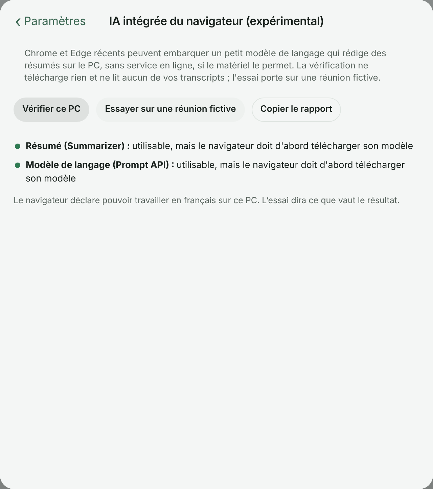

**Mon fichier est refusé.**
Lowsper lit le contenu du fichier, pas son extension. Formats lus en entier : WAV, MP3, M4A/AAC,
OGG/Opus, WebM. Un autre format (FLAC, Vorbis, WMA...) n'est accepté que jusqu'à 25 Mo, et
seulement si le navigateur sait le lire : convertissez-le en MP3 ou M4A, ou découpez-le. Un
fichier abîmé (enregistrement interrompu) est lu jusqu'à l'endroit où il est intact.

**J'enchaîne plusieurs réunions.**
Bouton « Réunion suivante » (icône lecture-fin, aussi dans la mini-fenêtre) : la réunion en cours
se termine et la suivante commence aussitôt, sans repartager l'écran. La réunion terminée est
enregistrée dans vos Téléchargements dès qu'elle est prête, chacune dans son propre fichier.

**Il manque des passages dans le transcript.**
Regardez la ligne « Couverture » en haut du transcript : elle dit si toute la parole détectée a
été transcrite. Pendant la réunion, Lowsper garde le son en mémoire : en fin de réunion, il le
relit et transcrit toute parole qui aurait échappé au direct (ligne « Rattrapage »). Si un problème
persiste, téléchargez le « Journal technique » sur l'écran de fin (aucun texte de réunion dedans)
et transmettez-le. Si le moteur échoue sur un passage, Lowsper le relance sur un moteur neuf ; s'il
échoue encore, le passage est signalé à sa place et un bouton « Réessayer ces passages » apparaît
sur l'écran de fin. Rien n'est perdu en silence.

**Les boutons de la mini-fenêtre ne répondent pas.**
Utilisez le bouton « Terminer la réunion » de la page principale de Lowsper : il fonctionne même si
la mini-fenêtre est bloquée. Le texte déjà transcrit n'est jamais perdu (il est proposé au
lancement suivant si le navigateur se ferme).

**Le modèle est retéléchargé à chaque fois.**
Vérifiez que Lowsper n'est pas ouvert directement depuis le zip (clic droit sur le zip, « Extraire
tout »). Après avoir téléchargé une nouvelle version de Lowsper, copiez le dossier `app\models`
de l'ancienne version dans la nouvelle au lieu de retélécharger (et le fichier `app\reglages.txt`,
qui contient vos sigles et préférences, ainsi que le dossier `Notes`, qui contient vos notes).

**Lowsper va-t-il ralentir mon PC pendant les réunions ?**
Non, par défaut (puissance « Équilibrée ») il n'utilise qu'environ un quart du processeur, un peu
plus seulement quand il prend du retard. Si la réunion est très dense, une « voie rapide » affiche
quand même le texte en direct (en italique), puis le retranscrit précisément dès que possible.
Réglable dans paramètres : Économe, Équilibrée, Maximale.

**Lowsper trouve trop ou pas assez d'intervenants.**
Indiquez le nombre de personnes (vous compris) sur l'écran d'accueil, à côté du nom de la réunion :
c'est le réglage le plus fiable (2 pour un entretien en tête-à-tête). Sans indication, Lowsper estime lui-même le nombre de voix (12 au
maximum). Deux voix très proches peuvent être regroupées : renommez-les à la fin de la réunion.

**Mon PC est-il assez rapide ?**
paramètres, « Mesurer la vitesse de ce PC » (fait automatiquement la première fois) : Lowsper indique
la charge estimée pour une réunion où l'on parle sans arrêt, et conseille un modèle plus rapide si
besoin.

**Lowsper peut-il reconnaître mes collègues d'une réunion à l'autre ?**
Oui, si vous l'activez (paramètres, « Mémoriser les voix », désactivé par défaut). Nommez les
intervenants à la fin d'une réunion : aux réunions suivantes, leurs voix sont reconnues. Une
empreinte vocale est une donnée biométrique : demandez l'accord des personnes. Les empreintes
restent sur votre poste, chacune est effacée automatiquement après 1, 3 ou 6 mois, et toutes
peuvent être effacées à tout moment.

**Un collègue n'est pas reconnu parce qu'il a changé de micro. Que faire ?**
Nommez-le à la fin de la réunion, comme la première fois. Lowsper garde jusqu'à cinq empreintes
par personne (casque, micro du portable, téléphone...) et compare chaque voix à la plus proche :
la fois suivante, il sera reconnu sur ce micro aussi. Lowsper préfère ne rien proposer plutôt
qu'un mauvais nom : une voix qui ressemble presque autant à deux collègues reste sans nom. Mesuré
sur des voix de synthèse (decision.md §37) : environ deux voix sur trois reconnues, moins de 5 %
de mauvais noms ; non vérifié sur de vraies réunions.

**Comment garder Lowsper visible pendant la visio ?**
Par défaut, Lowsper se réduit en mini-fenêtre dès le démarrage : une barre de 300 x 48 pixels,
toujours au premier plan, à placer où vous voulez. Si le navigateur ne l'a pas ouverte (il exige
parfois un clic), utilisez le bouton « Mini-fenêtre ». Vous pouvez aussi réduire la hauteur de la
fenêtre de Lowsper : elle devient la même barre. Réglable dans les paramètres.

**Le partage d'écran ne propose pas « Partager l'audio ».**
Sur Windows, choisissez « Écran entier » : la case « Partager aussi l'audio du système » apparaît.
Pour une réunion dans le navigateur, partager l'onglet de la réunion fonctionne partout.
Sans son partagé, Lowsper continue avec le micro seul.

**Mon PC va-t-il chauffer ?**
Le silence n'est jamais traité, la parole est regroupée en blocs pour limiter les calculs, et
chaque voix utilise un seul cœur du processeur. Avec Whisper small, attendez-vous à ce qu'un cœur
travaille une bonne partie de la réunion ; le reste du PC reste disponible. Voir `decision.md` §6.

**Mes données partent-elles quelque part ?**
Non. La seule connexion autorisée est le téléchargement du modèle depuis Hugging Face au premier
lancement ; tout autre site est bloqué par la page elle-même. L'audio n'est jamais enregistré
sur le disque : il est seulement gardé en mémoire pendant la réunion (filet de sécurité contre les
pertes) et effacé en quittant la page. Seul le texte du transcript en cours est sauvegardé dans le navigateur (pour la
récupération en cas de plantage), et effacé à la réunion suivante.

**Comment passer en thème clair ou sombre ?**
Lowsper suit le thème de votre système. Le bouton lune (ou soleil) en haut à droite bascule
d'un clic ; « Paramètres », « Affichage » permet de revenir au choix automatique.

**Quel navigateur ?**
Microsoft Edge ou Google Chrome récents. Firefox ne sait pas installer le modèle (il n'a pas
l'accès aux dossiers) et ne capte pas le son d'un partage d'écran : il ne fonctionne qu'en micro
seul, dans un dossier Lowsper où le modèle a déjà été installé depuis Edge ou Chrome.

**J'utilise Brave : « Ce navigateur ne permet pas d'enregistrer le modèle ».**
Brave bloque par défaut l'écriture dans un dossier, dont Lowsper a besoin pour installer le
modèle et pour écrire les notes dans un dossier. Deux solutions :
1. l'autoriser : ouvrez `brave://flags`, cherchez « File System Access », choisissez « Enabled »,
   puis relancez Brave ;
2. ou installer le modèle une fois avec Microsoft Edge (clic droit sur `Lowsper.html`, « Ouvrir
   avec »), puis revenir dans Brave : le modèle est déjà dans le dossier. Sans la première
   solution, les notes vont alors dans les Téléchargements.

Lowsper reconnaît Brave et affiche ces explications au bon moment.

## Limites connues

- **Son de visio dégradé** : sur le son compressé d'une visio, Whisper small se trompe nettement
  plus que sur le micro (mesures dans `decision.md` §15.15 et §17.6). Un modèle plus gros
  (large-v3 turbo) aide, mais demande une carte graphique.
- **Paroles simultanées** : quand deux participants parlent en même temps, Whisper suit la voix la
  plus forte ; les réponses courtes de l'autre (« oui », « d'accord », « pardon, vas-y ») sont
  souvent perdues. Vos propres paroles, sur le micro, restent captées, surtout avec un casque
  (mesures dans `decision.md` §39).
- **Compte rendu en haut de la note** : sur des réunions de test, la moitié des phrases utiles
  manquent en français et trois sur dix en anglais, surtout les décisions dites sans formule et,
  en français, les questions dont Whisper perd le point d'interrogation ; huit phrases recopiées
  sur dix sont justes. Mesuré sur des réunions fictives à voix de synthèse, en français et en anglais
  seulement, pas sur de vraies réunions (`decision.md` §40).
- **Notes rapides** : elles se tapent dans la fenêtre de Lowsper, pas dans la mini-fenêtre (trop
  petite). Leur heure est celle de la première frappe : si vous commencez une note puis attendez
  avant de l'écrire, l'heure est celle du début. Elles n'apparaissent pas sur l'écran de fin, seulement
  dans la note enregistrée et dans ce que copie « Obtenir un résumé ».
- **Voix proches** : deux personnes à la voix proche peuvent partager un numéro d'intervenant.
- **Mesures** : vitesses mesurées sur une machine de développement lente, qualité mesurée sur des
  voix de synthèse. Le test de vitesse intégré (paramètres) donne la réalité de votre PC.
- **Navigateurs** : Edge et Chrome. Brave après un réglage (voir la FAQ). Firefox seulement en
  micro seul, avec un modèle déjà installé.
- **Langues parlées** : qualité mesurée sur des voix de synthèse, pas sur de vraies réunions. En
  mandarin, Whisper écrit parfois en caractères traditionnels. Les vocabulaires métier n'existent
  qu'en français et en anglais. Les filtres de phrases parasites restent pensés pour le français
  et l'anglais.
- **Interface en anglais** : l'essai de l'IA intégrée du navigateur porte sur une réunion fictive en français. Les messages
  techniques du navigateur lui-même (erreurs, fenêtres d'autorisation) sont dans sa propre langue.
- **Fichiers importés** : les formats sans lecteur dédié (FLAC, Vorbis...) sont limités à 25 Mo.
  Les horodatages d'un MP3 ou d'un AAC peuvent être décalés de quelques centièmes de seconde
  (délai propre à ces formats).
- **Dossier de notes** : l'accès est gardé par le navigateur ; il disparaît avec ses données
  (nettoyage, profil effacé) et doit alors être redonné. Le navigateur peut aussi redemander son
  accord à chaque ouverture de Lowsper : un clic sur l'accueil suffit. Que Chrome et Edge gardent
  ou non l'accord au dossier Lowsper après un redémarrage n'est pas encore vérifié.
- **Notes et nouvelle version** : les notes sont rangées dans le dossier de la version de Lowsper
  utilisée ; copiez le dossier `Notes` en passant à une nouvelle version.
- **Plusieurs copies de Lowsper** : toutes les pages ouvertes depuis le disque partagent la même
  mémoire du navigateur. Depuis la 4.2.1, une copie n'utilise jamais l'accès au dossier d'une
  autre (une ancienne version par exemple) : elle l'oublie et redemande son propre dossier au
  premier enregistrement. Avant la 4.2.1, une fenêtre pouvait demander l'accès au dossier d'une
  ancienne version, même supprimée : refusez-la.

## Feuille de route

Évolutions prévues, dans l'ordre (détail dans les [jalons](https://github.com/PercyaDJ/Lowsper/milestones)
et `decision.md`) :
1. **Refonte de l'interface** : style unique et épuré, pensé pour les débutants, interface en
   anglais et en français, installation guidée selon la puissance du PC, mini-fenêtre réduite au
   strict nécessaire. Spécifications : [docs/refonte.md](refonte.md), plan des lots : [docs/lots.md](lots.md).
   Livré : nouvelles couleurs, thème clair ou sombre (3.5.0) ; interface en français et en
   anglais (lot R2) ; premier lancement guidé avec recommandation du modèle (lot R3) ; nouvel
   accueil (lot R4) ; réunion avec mini-fenêtre et contrôle d'état (lot R5) ; fin de réunion
   (lot R6) ; paramètres en onglets (lot R7). Les lots R2 à R7 forment la version 4.0.0 ; les
   langues parlées multiples et les vocabulaires élargis (lot R8), la version 4.1.0 ; la mémoire des
   voix plus sûre d'une visio à l'autre (lot R9), la version 4.2.0.
2. **Compte rendu de réunion, sur le PC et hors ligne** ([docs/lots.md](lots.md)) : livrés, le
   compte rendu extractif en haut de la note (lot C1), les notes rapides tapées pendant la réunion
   et la consigne « e-mail de suivi » (lot C2). Un compte rendu rédigé par une IA locale a été
   mesuré et écarté (lot C3) : le seul petit modèle qui tient dans le navigateur invente des
   chiffres, des dates ou des personnes (`decision.md` §43).
3. **Résumé local** : la seule piste restante est l'IA intégrée de Chrome et d'Edge, à mesurer
   sur de vrais PC avec la sonde des paramètres (`decision.md` §22, §23 et §43). D'ici là,
   « Obtenir un résumé » reste la voie recommandée.

Une idée, un problème ? Ouvrez une [issue](https://github.com/PercyaDJ/Lowsper/issues/new/choose),
ou posez votre question dans les [discussions](https://github.com/PercyaDJ/Lowsper/discussions).

## Pour les développeurs

`app/engine` et `app/manifest.js` sont générés. Pour les reconstruire (Node.js 20 ou plus) :

```bash
cd tools
npm ci --ignore-scripts
node node_modules/esbuild/install.js
npm run fetch-all                    # modèles à la révision figée de models.lock.json, empreintes vérifiées
npm run build                        # moteur + catalogue, identique à l'octet près au dépôt
npm test                             # lint, formatage, tests unitaires, paquet, non-fuite réseau (comme la CI)
npm run release                      # paquet de distribution tools/dist/Lowsper-X.Y.Z.zip + empreinte
npm run test:e2e                     # installation + réunion simulée (corpus hebdo) dans Chromium, 4 min
node test/eval-hebdo.mjs whisper-small # réunion réaliste : phrases perdues, sigles, intervenants
node test/eval-hebdo.mjs whisper-small --corpus=entretien --vocab=cyber --title
                                     # entretien en tête-à-tête, son de visio, vocabulaire cyber
node build.mjs --embed whisper-small whisper-base && node test/eval.mjs whisper-small whisper-base
                                     # comparaison des modèles sur le corpus avec sigles
```

Si Playwright ne trouve pas son navigateur, indiquez-le : `CHROMIUM_PATH=/chemin/vers/chrome`.
`node build.mjs --embed whisper-small` produit aussi une version avec le modèle pré-installé,
pour une distribution sans aucun accès à Internet.

Pour aller plus loin :
- [docs/architecture.md](architecture.md) : le trajet du son, du micro au Markdown, module par module ;
- [AGENTS.md](../AGENTS.md) : règles du projet (contraintes, conventions, commandes) ;
- [CONTRIBUTING.md](../CONTRIBUTING.md) : proposer une modification ;
- [SECURITY.md](../SECURITY.md) : modèle de menace et signalement des failles ;
- [CHANGELOG.md](../CHANGELOG.md) : évolutions ; [decision.md](../decision.md) : décisions et mesures.

Structure :

```
Lowsper.html          page à ouvrir (interface + politique de sécurité)
app/css/              styles
app/js/i18n.js        langue de l'interface : catalogues français et anglais, fonction t()
app/js/recommend.js   détection du PC et modèle recommandé au premier lancement
app/js/menu.js        menu dessiné par Lowsper (composant commun, clavier et lecteur d'écran)
app/js/meeting.js     contrôle d'état de la réunion (micro, son, texte) et ses seuils
app/js/engine.js      chargement des fichiers, moteur Whisper dans un Worker (glossaire, langue)
app/js/installer.js   installation du modèle au premier lancement
app/js/settings.js    réglages copiés dans le dossier (survivent au nettoyage du navigateur)
app/js/analyzer.js    détection de parole (Silero) et empreintes vocales (WeSpeaker), dans un Worker
app/js/speakers.js    distinction et regroupement des intervenants
app/js/capture.js     capture micro / partage d'écran, détection de parole, découpage
app/js/languages.js   langues parlées proposées, ancien réglage relu, nom des langues dans la note
app/js/vocabularies.js listes des vocabulaires métier, par domaine et par langue
app/js/vocabulary.js  vocabulaires métier : corrections, termes alternés, contexte donné au moteur
app/js/transcript.js  assemblage, sigles, anti-écho, filtres, Markdown, sauvegarde
app/js/app.js         contrôleur de l'interface
app/engine/           runtime transformers.js + ONNX Runtime (généré)
app/models/           modèle(s) installé(s) au premier lancement (non versionné)
tools/                construction, verrou des modèles et tests (inutile pour l'utilisateur final)
docs/                 architecture, guide de déploiement, captures d'écran
decision.md           décisions techniques et arbitrages
AGENTS.md             règles du projet pour les contributeurs et les agents de code
SECURITY.md           modèle de menace, signalement des failles
```

## Licences

- Code Lowsper : MIT.
- Modèle Whisper (OpenAI) : MIT. Conversions ONNX : `onnx-community/whisper-small`, `onnx-community/whisper-base`.
- transformers.js (Hugging Face) : Apache 2.0. ONNX Runtime Web (Microsoft) : MIT.
- Silero VAD (détection de parole) : MIT. WeSpeaker ResNet34 (empreintes vocales,
  `onnx-community/wespeaker-voxceleb-resnet34-LM`) : CC BY 4.0.
- Textes complets : `app/engine/THIRD_PARTY_LICENSES.txt`.
